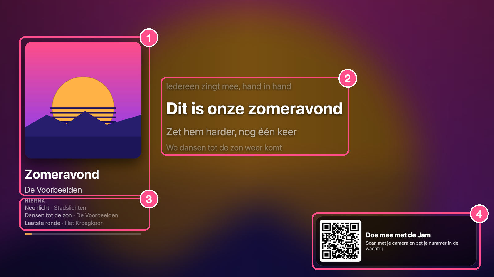
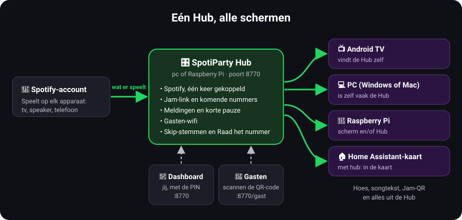
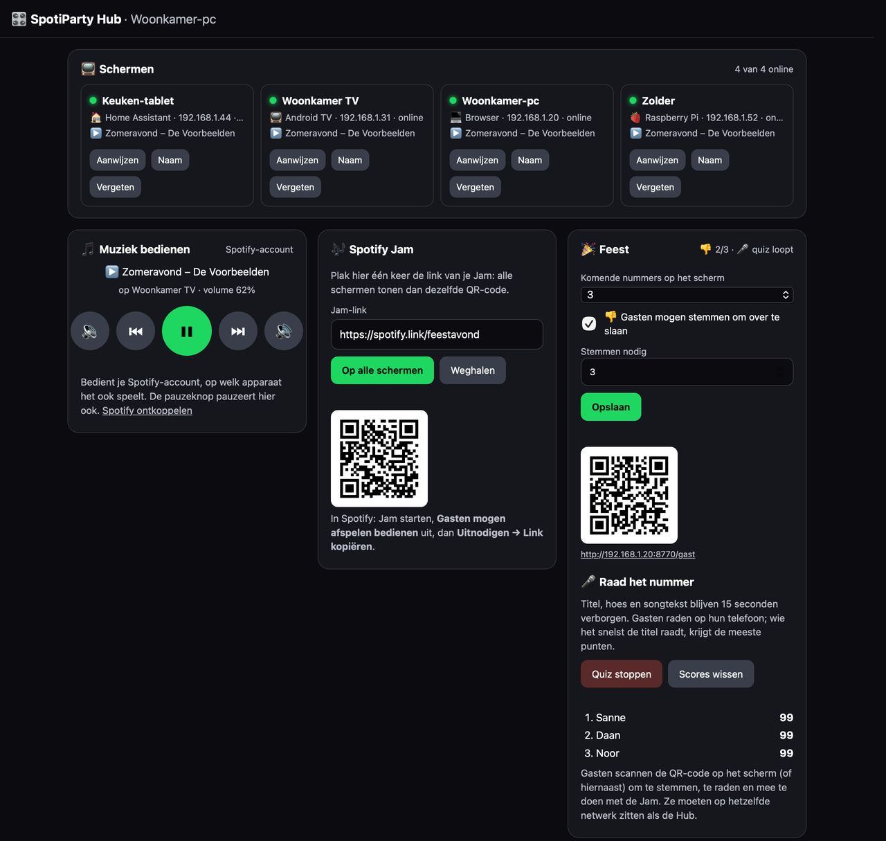
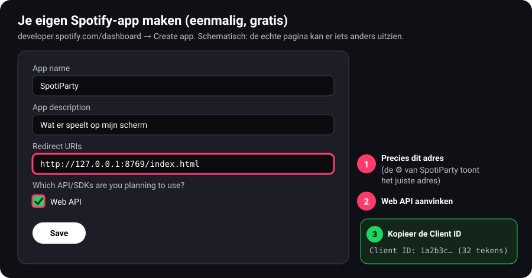
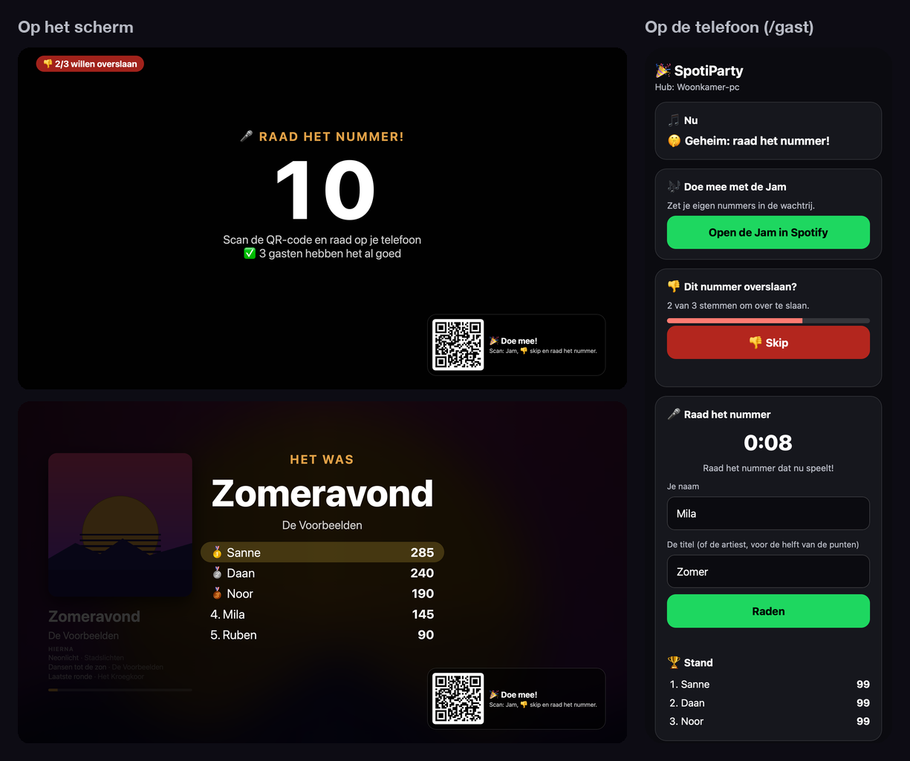
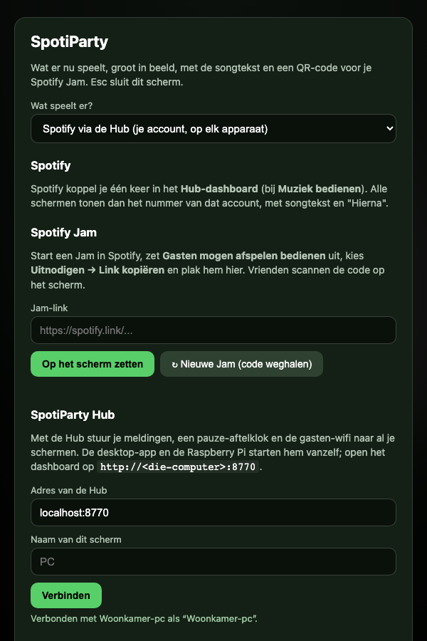
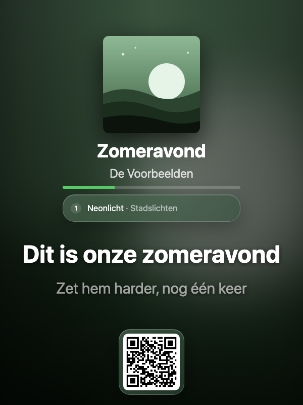

<div align="center">

# 🎉 SpotiParty

**Het nummer dat speelt, groot in beeld: met meelopende songtekst, de komende nummers en een QR-code waarmee je
vrienden meedoen met je Spotify Jam, het volgende nummer kiezen, muziekbingo spelen en meedoen met de muziekquiz.**

## [Website SpotiParty](https://spotiparty.netlify.app/#)

Voor je **Android TV**, je **PC**, een **Raspberry Pi** en je **Home Assistant**-dashboard, allemaal bestuurd vanuit
één **Hub**.

[](../../releases/latest)


</div>

---

> [!TIP]
> **Nieuw in [3.0.0](../../releases/tag/v3.0.0): een gloednieuwe SpotiParty.** Gasten **kiezen het volgende nummer**,
> spelen **muziekbingo** op hun telefoon en sturen **berichtjes** naar het scherm; alle punten tellen op tot de
> **winnaar van de avond**. Plus: wissel tussen **Spotify-accounts** in de Hub. De Windows- en Mac-app werken zichzelf
> bij; kom je van 2.6.0 of ouder, installeer dan
> [`SpotiParty-Setup-3.1.1.exe`](../../releases/download/v3.1.1/SpotiParty-Setup-3.1.1.exe) één keer met de hand.
> Zie [Wat is er nieuw](#-wat-is-er-nieuw).

**Home Assistant?** 

[](https://my.home-assistant.io/redirect/hacs_repository/?owner=CodeAura&repository=SpotiParty&category=plugin)

## Inhoud

- [Wat het doet](#-wat-het-doet)
- [Wat is er nieuw](#-wat-is-er-nieuw)
- [Hoe het in elkaar zit](#-hoe-het-in-elkaar-zit)
- [Snel aan de slag](#-snel-aan-de-slag)
- [De SpotiParty Hub](#%EF%B8%8F-de-spotiparty-hub)
- [Spotify koppelen aan de Hub](#-spotify-koppelen-aan-de-hub)
- [Feestspellen](#-feestspellen)
- [Webapp op de PC](#-webapp-op-de-pc)
- [Raspberry Pi](#-raspberry-pi)
- [Installeren op de tv](#-installeren-op-de-tv)
- [Home Assistant](#-home-assistant)
- [Een Spotify Jam starten](#-een-spotify-jam-starten)
- [Opties en sneltoetsen](#%EF%B8%8F-opties-en-sneltoetsen)
- [Problemen oplossen](#-problemen-oplossen)
- [Privacy](#-privacy)
- [Voor ontwikkelaars](#-voor-ontwikkelaars)

---

## ✨ Wat het doet



| | |
|---|---|
| **1. Wat er speelt** | De hoes, titel, artiest en voortgang. De hoes ligt wazig over de hele achtergrond en de balk krijgt de kleur van de hoes. Bij elk nieuw nummer draait de hoes in beeld; staat de muziek op pauze, dan wordt het nummer gedimd. |
| **2. Songtekst** | De regel die gezongen wordt staat groot in het midden en loopt in de maat mee. De teksten komen van [lrclib.net](https://lrclib.net): gratis en zonder account. |
| **3. Hierna** | De **komende 1, 3 of 5 nummers** uit de wachtrij van je Spotify-account; hoeveel kies je in het Hub-dashboard. Loopt er een stemming over het volgende nummer, dan staat hier tijdelijk de stemkaart. |
| **4. QR-code** | Vrienden scannen de code met hun camera en zetten hun eigen nummers in de Jam-wachtrij. Staan de feestspellen aan, dan leidt de code naar de **gastenpagina**, en zegt de kaart precies wat scannen doet. |

Daarnaast zet je vanuit het **Hub-dashboard** meldingen, een pauze-aftelklok en een QR-code voor je gasten-wifi op
al je schermen tegelijk, en verschijnen goedgekeurde **berichtjes van gasten** in een balkje boven de songtekst. Alles
wat over het scherm heen komt, is van glas over dezelfde wazige hoes.

---

## 🆕 Wat is er nieuw

| Versie | Wat er veranderde |
|---|---|
| **[3.1.1](../../releases/tag/v3.1.1)** (nieuwste) | De Windows- en Mac-app starten de Hub ook als poort 8770 na een update nog even bezet is; blijft hij bezet, dan zegt het venster door welk programma. |
| [3.1.0](../../releases/tag/v3.1.0) | **Opstartscherm:** het feestscherm begint met het SpotiParty-logo, de naam en de maker, en vervaagt dan in het scherm. Overslaan kan met `?splash=0`. |
| [3.0.1](../../releases/tag/v3.0.1) | **Stem het volgende nummer** duurt nu **60 seconden**, met een aftelklok op het scherm en op de telefoon. |
| [3.0.0](../../releases/tag/v3.0.0) | **Een gloednieuwe SpotiParty.** Nieuwe feestspellen: **Stem het volgende nummer** (de winnaar gaat in de wachtrij), **Muziekbingo** met een eigen kaart op elke telefoon, **berichten van gasten** in een balkje boven de songtekst en de **stand van de avond** met een winnaar op alle schermen. Kies een **afspeellijst** voor de spellen in het dashboard. |
| [2.10.2](../../releases/tag/v2.10.2) | **Mac:** de app bereikt Spotify en GitHub weer. Had je 2.10.0 of 2.10.1 op de Mac, installeer deze versie dan één keer met de hand. |
| [2.10.1](../../releases/tag/v2.10.1) | De Hub wisselt nooit meer zelf van Spotify-account: alleen jij kiest het actieve account. |
| [2.10.0](../../releases/tag/v2.10.0) | **Account-wisselaar:** koppel tot vijf Spotify-accounts aan de Hub en kies in het dashboard met één tik welk account actief is. |
| [2.9.0](../../releases/tag/v2.9.0) | **Hub op een server werkt zichzelf bij**, elke nacht, en je kiest de PIN bij de eerste start. **Mac-installer:** de `.dmg` opent als venster om SpotiParty naar Apps te slepen. **Smalle schermen** (Home Assistant-kaart, tablet, telefoon) passen beter. |
| [2.8.0](../../releases/tag/v2.8.0) | **Nieuwe look:** meldingen, de pauze, de quiz en *Hierna* zijn glas over de wazige hoes; iconen in plaats van emoji; een animatie bij elk nieuw nummer. **Hub op een Linux-server** met systemd of Docker, en het scherm op `http://<hub>:8770/scherm/`. **De tv-app toont hetzelfde scherm als de webapp**, rechtstreeks van de Hub. |
| [2.7.1](../../releases/tag/v2.7.1) | **Ook de Mac-app werkt zichzelf bij**, net als op Windows: downloaden op de achtergrond, installeren bij de volgende start of met **Nu bijwerken**. De Mac-app (Apple silicon) staat vanaf nu bij elke release. |
| [2.7.0](../../releases/tag/v2.7.0) | **Automatische updates op Windows.** SpotiParty kijkt bij het starten en daarna elke 6 uur of er een nieuwe versie is, downloadt die op de achtergrond en installeert hem bij de volgende start, of meteen met **Nu bijwerken**. Je instellingen blijven bewaard. Het versienummer staat in de titel van het SpotiParty-venster. |
| [2.6.0](../../releases/tag/v2.6.0) | **Feestspellen:** komende nummers op het scherm, 👎 stemmen om over te slaan, 🎤 *Raad het nummer* en de gastenpagina op `http://<hub>:8770/gast`. |
| [2.5.1](../../releases/tag/v2.5.1) | Kan een scherm de Hub niet bereiken, dan staat er bovenin een rode melding **⚠️ Hub niet verbonden**, met de reden erbij. |
| [2.5.0](../../releases/tag/v2.5.0) | Spotify koppel je **alleen nog in de Hub**. Alle schermen tonen het nummer van dat account; de schermen hebben geen eigen Spotify-login meer. |
| [2.4.2](../../releases/tag/v2.4.2) | SpotiParty staat in **HACS** als dashboardkaart voor Home Assistant. |

Alle versies en downloads vind je bij [Releases](../../releases).

---

## 🧭 Hoe het in elkaar zit



De **Hub** is het hart: een klein programma op je PC of Raspberry Pi met een admin-dashboard op poort **8770**. Daar
koppel je één keer je Spotify-account en je Jam-link, en alle schermen in huis volgen dat.

| | 💻 PC (Windows of Mac) | 🍓 Raspberry Pi | 📺 Android TV | 🏠 Home Assistant |
|---|---|---|---|---|
| **Rol** | Scherm **en** Hub | Scherm en/of Hub | Scherm | Scherm (kaart) |
| **Toont** | Je Spotify-account, via de Hub | Je Spotify-account, via de Hub | Wat er op de tv speelt, of het account van de Hub | Elke `media_player`, of het account van de Hub |
| **Nodig** | `SpotiParty-Setup-<versie>.exe`, of de `.dmg` op een Mac met Apple silicon | Raspberry Pi OS (64-bit) met desktop | ADB en een PC om te bouwen | Home Assistant, liefst met HACS |
| **Updates** | Vanzelf (Windows vanaf 2.7.0, Mac vanaf 2.7.1) | `sudo ./pi/install.sh` opnieuw | Opnieuw bouwen en installeren | Via HACS |
| **Tijd** | ± 5 min | ± 10 min | ± 20 min | ± 5 min |

---

## 🚀 Snel aan de slag

1. **Installeer de Hub.** Het makkelijkst met de Windows- of Mac-app (zie [Webapp op de PC](#-webapp-op-de-pc)) of op een
   [Raspberry Pi](#-raspberry-pi). Het venster toont het adres van het dashboard en de **PIN**.
2. **Open het dashboard** op `http://<adres-van-die-pc>:8770`, ook op je telefoon, en vul de PIN in.
3. **Koppel Spotify** bij **🎵 Muziek bedienen** (zie [Spotify koppelen aan de Hub](#-spotify-koppelen-aan-de-hub)).
4. **Plak je Jam-link** bij **🎶 Spotify Jam** en kies **Op alle schermen**.
5. **Zet er schermen bij:** een [tv](#-installeren-op-de-tv), een [Home Assistant-kaart](#-home-assistant) of een tweede
   pc. Ze melden zich vanzelf in het dashboard onder **📺 Schermen**.

---

## 🎛️ De SpotiParty Hub

De desktop-app en de Raspberry Pi starten de Hub vanzelf. Open daarna `http://<adres-van-die-computer>:8770` en vul de
PIN in. Er draait één Hub per netwerk: start je de app op een tweede pc, dan wordt die een scherm van de eerste Hub.

**Op een server die altijd aan staat?** De Hub draait ook zonder scherm op Linux, met systemd of Docker:
`sudo ./server/install.sh` of `cd server && docker compose up -d --build`. Het feestscherm staat dan op
`http://<server>:8770/scherm/`, voor elke browser of smart-tv. Zie [Hub op een Linux-server](docs/hub/linux-server.md).



| Onderdeel in het dashboard | Wat het doet |
|---|---|
| **📺 Schermen** | Alle SpotiParty-schermen in huis, met wat er speelt. Groen is online. **Aanwijzen** zet de naam groot op dat scherm; **Naam** geeft het een eigen naam. |
| **🎵 Muziek bedienen** | Spotify koppelen, en daarna vorige, afspelen/pauze, volgende en het volume, op welk apparaat je account ook speelt. Koppel tot vijf accounts en kies zelf met één tik welk account actief is. |
| **🎶 Spotify Jam** | Eén Jam-link voor alle schermen, met een voorbeeld van de QR-code. |
| **🎉 Feest** | Hoeveel komende nummers de schermen tonen, de Skip-stemmen en *Raad het nummer*. Zie [Feestspellen](#-feestspellen). |
| **💬 Melding** | Een bericht ("De pizza's zijn er! 🍕") groot op de schermen die je kiest, in de stijl Gewoon, Feest of Belangrijk. |
| **⏸️ Korte pauze** | Een aftelklok van 5 tot 30 minuten, of zelf gekozen. Als je wilt, pauzeert de Hub ook de muziek en zet hem na afloop weer aan. |
| **📶 Gasten-wifi** | Een QR-code naast de Jam-code, zodat gasten met één scan op je gastennetwerk zitten. |
| **⚙️ Hub** | De naam van de Hub en een eigen PIN. |

> [!WARNING]
> **Windows** vraagt de eerste keer of SpotiParty op het netwerk mag. Kies **Privénetwerken**, anders kunnen de tv en
> je telefoon de Hub niet bereiken. Zet poort 8770 **niet** open in je router: de Hub hoort alleen in je eigen netwerk.

Alles wat iets verandert, vraagt de PIN. Na vijf foute pogingen wacht de Hub een minuut. Meer in
[docs/hub](docs/hub/hub-dashboard.md).

---

## 🔑 Spotify koppelen aan de Hub

Sinds versie 2.5.0 koppel je Spotify **op één plek: de Hub**. Daarvoor heb je een eigen, gratis Spotify-app nodig.
Spotify vraagt dit om te weten welke app je login gebruikt.



1. Ga naar **[developer.spotify.com/dashboard](https://developer.spotify.com/dashboard)**, log in met je eigen
   Spotify-account en kies **Create app**.
2. Vul een naam en een omschrijving in, wat je maar wilt.
3. Zet bij **Redirect URIs** precies dit adres:

   ```
   http://127.0.0.1:8770/spotify/callback
   ```

   Het dashboard toont het ook bij **🎵 Muziek bedienen**. Gebruik `127.0.0.1`, niet `localhost`: dat weigert Spotify.
4. Vink **Web API** aan en kies **Save**.
5. Kopieer de **Client ID** (32 tekens met cijfers en de letters a tot en met f), plak hem in het dashboard en klik
   **Inloggen bij Spotify**.
6. Log je in op je **telefoon**? Dan probeert die daarna `127.0.0.1` te openen en lukt dat niet. Dat hoort zo:
   kopieer het hele adres uit de adresbalk, plak het in het dashboard en klik **Koppelen**.

> [!IMPORTANT]
> Sinds februari 2026 gelden strengere regels voor apps in *Development Mode*: de eigenaar van de app heeft
> **Spotify Premium** nodig, je mag **één** Client ID hebben en er mogen maximaal **vijf** accounts inloggen (onder
> **User Management**). Bron: [Spotify for Developers, migratiegids februari 2026](https://developer.spotify.com/documentation/web-api/tutorials/february-2026-migration-guide).
> Gasten die alleen via de Jam nummers toevoegen, hoeven niets: zij gebruiken hun eigen Spotify.

---

## 🎉 Feestspellen

Alles stel je in bij **🎉 Feest** in het Hub-dashboard. Ze werken op de Windows- en Mac-app, de Android TV-app,
de Raspberry Pi en de Home Assistant-kaart.



| | |
|---|---|
| **Komende nummers** | De schermen tonen de volgende **1, 3 of 5** nummers uit de wachtrij van je Spotify-account, of geen. |
| **👎 Stemmen om over te slaan** | Gasten scannen de QR-code en tikken op **Skip**. Bij genoeg stemmen (instelbaar, standaard 3) slaat de Hub het nummer over. Het scherm toont hoeveel stemmen er zijn. |
| **🎤 Raad het nummer** | Bij elk nieuw nummer blijven titel, hoes en songtekst **15 seconden** verborgen. Gasten raden op hun telefoon: snel de titel goed levert tot **100 punten** op, de artiest goed de helft, met maximaal **3 pogingen** per nummer. Daarna verschijnen het antwoord en de **top 5**. |
| **Stem het volgende nummer** | Gasten kiezen op hun telefoon uit drie nummers uit een afspeellijst. Er wordt **60 seconden** gestemd; zolang staat de stemkaart met een aftelklok op de plek van *Hierna*. Daarna zet de Hub de winnaar in de wachtrij en is *Hierna* terug. Goed gekozen: **10 punten**. |
| **Muziekbingo** | Elke gast krijgt op zijn telefoon een kaart met 16 titels uit een afspeellijst. Wat speelt, kleurt groen; wie een volle rij, kolom of diagonaal heeft, tikt op **Bingo!** en staat groot op het scherm (**150, 100, 50 punten**). |
| **Berichten van gasten** | Gasten sturen een kort berichtje; jij keurt het goed en het staat even in een balkje boven de songtekst. |
| **Stand van de avond** | De punten van alle spellen bij elkaar. Aan het eind zet je de winnaar met de top 5 groot op alle schermen. |

Gasten doen mee via de **gastenpagina** op `http://<hub-ip>:8770/gast`: de Jam-link en alle spellen in één. Staat er een
spel aan, dan leidt de QR-code op de schermen daarheen. Uitleg per spel: [Feestspellen](docs/hub/feestspellen.md).

> [!NOTE]
> Gasten moeten op **hetzelfde netwerk** zitten als de Hub. Een afgeschermd gasten-wifi kan de gastenpagina niet
> bereiken.

---

## 💻 Webapp op de PC

### Windows-app (aanbevolen)

Download bij de nieuwste [**Release (3.1.1)**](../../releases/latest):

| Bestand | Installeren |
|---|---|
| [`SpotiParty-Setup-3.1.1.exe`](../../releases/download/v3.1.1/SpotiParty-Setup-3.1.1.exe) | Voor **Windows 10/11** (64-bit). Dubbelklik en volg de stappen. SpotiParty komt in het Startmenu en, als je dat aanvinkt, op je bureaublad. Er zijn geen beheerdersrechten nodig. Verwijderen gaat via **Instellingen → Apps**. |

SpotiParty opent het feestscherm in een eigen venster, zonder tabbladen, en start de Hub. Er verschijnt ook een klein
venster met het adres en de **PIN** van het dashboard, en de knoppen **Scherm openen**, **Dashboard** en **Stoppen**.
Sluit je dat kleine venster, dan stopt SpotiParty.

> [!WARNING]
> De app is niet bij Microsoft geregistreerd. Daarom toont Windows bij de **eerste** start *"Windows heeft uw pc
> beschermd"*. Klik **Meer informatie** en dan **Toch uitvoeren**.

**Updaten gaat vanzelf** (vanaf 2.7.0). Staat er een nieuwe versie klaar, dan zie je dat in het SpotiParty-venster.
De update wordt geïnstalleerd bij de volgende start, of meteen met **Nu bijwerken**; de schermen stoppen dan even.
Kom je van 2.6.0 of ouder, draai dan één keer met de hand de nieuwe setup.

### Mac en Linux

Voor een **Mac met Apple silicon** staat `SpotiParty-macos-apple-silicon.dmg` bij de nieuwste release: open hem en sleep
**SpotiParty** naar **Apps**. Vanaf 2.7.1 werkt ook de Mac-app zichzelf bij. Op een Intel-Mac en op Linux
start je SpotiParty met Python (hieronder), of je bouwt de Mac-app zelf met `./desktop/build-macos.sh`
(zie [desktop/README.md](desktop/README.md)).

### Starten met Python

Heb je [Python 3](https://www.python.org/downloads/)? Start dan de app met Hub:

```bash
python desktop/spotiparty_app.py
```

Of alleen het scherm (op Windows kan dat ook met een dubbelklik op `web/start.cmd`):

```bash
python web/serve.py
```

Het scherm draait op `http://127.0.0.1:8769/index.html`. Dat luistert alleen op je eigen pc; niemand anders in het
netwerk kan erbij. Draait de Hub op een andere computer, vul dan het adres in bij ⚙ → **SpotiParty Hub**.

### Instellen



Open de instellingen met **S**, of met de ⚙ die verschijnt zodra je de muis beweegt. Kies bij **Wat speelt er?**
*Spotify via de Hub* of een *Home Assistant media player*. Spotify en de Jam-link stel je in het Hub-dashboard in;
op het scherm zelf geef je hooguit het adres van de Hub en een naam voor dit scherm.

Druk op **F** voor volledig scherm. De muisaanwijzer verdwijnt vanzelf na 2,5 seconde. Sluit je de pc op een tweede
scherm of beamer aan, dan heb je zo een feestscherm.

---

## 🍓 Raspberry Pi

Een Raspberry Pi 4 of 5 aan een tv of beamer is een prima vast feestscherm, en kan meteen de Hub zijn. Je hebt
**Raspberry Pi OS (64-bit) met desktop** nodig, Bookworm of nieuwer, met automatisch inloggen aan.

```bash
git clone https://github.com/CodeAura/SpotiParty.git
cd SpotiParty
sudo ./pi/install.sh
sudo reboot
```

| Wat je wilt | Commando |
|---|---|
| Scherm + Hub (standaard) | `sudo ./pi/install.sh` |
| Alleen een scherm, Hub elders | `sudo ./pi/install.sh --hub 192.168.1.20` |
| Alleen de Hub (Pi zonder scherm) | `sudo ./pi/install.sh --no-screen` |
| Een eigen naam in het dashboard | `sudo ./pi/install.sh --name "Keuken"` |
| Verwijderen | `sudo ./pi/install.sh --uninstall` |

Bijwerken: `git pull` en `sudo ./pi/install.sh` opnieuw; je instellingen blijven bewaard. Meer in
[docs/raspberry-pi](docs/raspberry-pi/README.md).

---

## 📺 Installeren op de tv

Dit werkt op Android TV en Google TV met Android 8 of nieuwer, zoals Chromecast met Google TV, Sony, Philips,
TCL, Hisense en NVIDIA Shield. Je installeert één app: **SpotiParty**. Die toont hetzelfde scherm als de webapp,
rechtstreeks van je Hub (`http://<hub>:8770/scherm/`). Werkt de Hub zichzelf bij, dan heeft de tv meteen de nieuwe
versie: de app zelf hoef je daarvoor niet opnieuw te installeren.


### Stap 1: Debuggen aanzetten op de tv

1. Ga naar **Instellingen → Systeem → Over** en klik **7 keer** op **Android TV OS-build**. Je ziet daarna
   *"Je bent nu ontwikkelaar"*.
2. Zet in **Instellingen → Systeem → Ontwikkelaarsopties** de optie **USB-foutopsporing** aan, of
   **Netwerkfoutopsporing** als je tv die heeft.
3. Noteer het IP-adres van de tv. Dat vind je onder **Instellingen → Netwerk en internet → je wifi-netwerk**.

### Stap 2: De apps bouwen op je PC

Je hebt **JDK 17** en de **Android SDK** (platform 34) nodig. Installeer je
[Android Studio](https://developer.android.com/studio), dan krijg je beide.

```bash
git clone https://github.com/CodeAura/SpotiParty.git
cd SpotiParty/android/party-mode
./gradlew assembleRelease
cd ../..
```

Op Windows schrijf je `gradlew.bat assembleRelease` in plaats van `./gradlew assembleRelease`.

### Stap 3: Installeren

```bash
adb connect 192.168.1.50
```

Vervang `192.168.1.50` door het IP-adres van je tv. Op de tv verschijnt **"USB-foutopsporing toestaan?"**: kies
**Toestaan**. Installeer daarna de app:

```bash
adb install -r android/party-mode/app/build/outputs/apk/release/app-release.apk
```

Had je de oude **Lyrics**-app nog? Die is niet meer nodig: `adb uninstall io.github.cleanyourtv.lyrics`.

### Stap 4: Toegang geven

SpotiParty moet kunnen zien wat er speelt. Dat heet in Android **Meldingstoegang**. SpotiParty leest daarbij
geen enkele melding.

**Via de instellingen van de tv:** ga naar **Instellingen → Apps → Speciale app-toegang**.

| Instelling | | Waarvoor |
|---|---|---|
| **Meldingstoegang** → SpotiParty | ✅ verplicht | Zien welk nummer er speelt |
| **Weergeven vóór andere apps** → SpotiParty | ⭕ optioneel | SpotiParty mag vanzelf openen zodra Spotify begint te spelen |

**Of via ADB:** sommige tv's verstoppen deze schermen. Het eerste commando geeft Meldingstoegang:

```bash
adb shell cmd notification allow_listener io.github.cleanyourtv.partymode/io.github.cleanyourtv.partymode.PartyListener
```

Het tweede commando is optioneel:

```bash
adb shell appops set io.github.cleanyourtv.partymode SYSTEM_ALERT_WINDOW allow
```

> [!TIP]
> Ben je klaar, zet **USB-/Netwerkfoutopsporing** dan weer uit in de Ontwikkelaarsopties. Zolang dat aan staat,
> kan elk apparaat in je netwerk vragen om de tv te bedienen.

### Stap 5: Openen en verbinden met de Hub

1. Open **SpotiParty** op de tv.
2. De tv **zoekt de Hub zelf** op het netwerk, laadt het scherm van de Hub en verschijnt in het dashboard onder
   **Schermen**. De Jam-link, de komende nummers, meldingen, de pauze en de feestspellen komen allemaal uit de Hub.
3. Vindt de tv de Hub niet (sommige routers blokkeren dat), vul dan op de tv het adres in dat in het dashboard staat,
   bijvoorbeeld `192.168.1.20:8770`, en kies **Verbinden**.
4. Met **Menu** op de afstandsbediening open je de instellingen van het scherm: de naam van de tv, het adres van de
   Hub en **SpotiParty vanzelf openen als Spotify begint te spelen** (standaard uit).

Heeft de Hub geen nummer (er is nog geen Spotify-account gekoppeld), dan toont de tv wat er op de tv zelf speelt.
De afstandsbediening pauzeert en slaat over, ook als de muziek van de Hub komt.

---

## 🏠 Home Assistant

SpotiParty is een kaart voor je Home Assistant-dashboard: als gewone kaart of over het hele scherm, voor een
wandtablet of een tv met je dashboard. De kaart volgt elke `media_player` (Spotify, Sonos, Cast, Music Assistant…)
en toont met de Hub het nummer van je Spotify-account, met songtekst, Jam-code, meldingen, de pauze en de feestspellen.

### Stap 1: Installeren via HACS (aanbevolen)

Met [HACS](https://hacs.xyz) installeer je SpotiParty in één klik, en krijg je updates vanzelf te zien.

[](https://my.home-assistant.io/redirect/hacs_repository/?owner=CodeAura&repository=SpotiParty&category=plugin)

1. Klik op de knop, controleer het adres van je Home Assistant en klik **Open link**.
2. Klik in HACS op **Downloaden** (of later **Bijwerken**) en herlaad de browser met **Ctrl+F5**.

Werkt de knop niet? Ga dan naar **HACS → ⋮ → Aangepaste repositories**, plak `https://github.com/CodeAura/SpotiParty`,
kies type **Dashboard**, klik **Toevoegen** en daarna **Downloaden**.

<details>
<summary><b>Zonder HACS installeren</b></summary>

1. Download [**`spotiparty-card.js`**](../../releases/latest/download/spotiparty-card.js) bij de
   [nieuwste release](../../releases/latest). Het is één bestand; het hele scherm zit erin.
2. Zet het in **`/config/www/spotiparty/`**, met de add-on **File editor**, **Studio Code Server** of **Samba share**.
   Bestond de map `www` nog niet? Herstart Home Assistant dan één keer.
3. Voeg het toe bij **Instellingen → Dashboards → ⋮ → Bronnen**: `/local/spotiparty/spotiparty-card.js`, type
   **JavaScript-module**.

Een update is hetzelfde bestand opnieuw neerzetten, en daarna **Ctrl+F5**.
</details>

### Stap 2: Kaart toevoegen

Kies **✏️ Dashboard bewerken → + Kaart toevoegen**, zoek **SpotiParty**, of plak dit in de code-editor van een
handmatige kaart:

```yaml
type: custom:spotiparty-card
hub: http://192.168.1.20:8770
fullscreen: true
```

Vervang `192.168.1.20` door het adres van de pc of Pi waar de Hub draait. Dat staat in het SpotiParty-venster op die
pc, en bovenaan het Hub-dashboard.

### Stap 3: Instellingen van de kaart

| Instelling | Wat het doet |
|---|---|
| `hub: http://…:8770` | Het adres van je SpotiParty Hub. **Nodig** voor de Jam-code, meldingen, de pauze, de feestspellen en het nummer van je Spotify-account: een webpagina in Home Assistant kan de Hub niet zelf vinden. |
| `fullscreen: true` | Over het hele Home Assistant-venster, zonder zijbalk en kopregel. Met **✕** linksboven ga je terug naar het dashboard. |
| `height: 600px` | De hoogte als gewone kaart (standaard `480px`). |
| `entity: media_player.woonkamer` | Een vaste speler. Zonder deze regel volgt SpotiParty de speler die op dat moment speelt. |
| `name: Woonkamer-tablet` | De naam van dit scherm in het Hub-dashboard. |

<table><tr>
<td></td>
<td>

**Werkt meteen, zonder token.** De kaart leest de spelers uit je eigen dashboard.

**Smalle kaart?** Dan zet SpotiParty alles onder elkaar, zoals links.

**Wandtablet of tv met je dashboard?** Gebruik `fullscreen: true`, of zet de kaart alleen in een weergave van het
type **Paneel**.

**Instellingen in de kaart:** klik erin en druk op **S**, of beweeg de muis en klik op ⚙. Daar zie je ook of de
kaart met de Hub verbonden is.

</td>
</tr></table>

> [!NOTE]
> Open je Home Assistant via **https://** (bijvoorbeeld Nabu Casa), dan mag de kaart de Hub op `http://` niet
> bereiken: dat blokkeert de browser. Open je dashboard op dat scherm via het lokale adres, bijvoorbeeld
> `http://homeassistant.local:8123`.

---

## 🎶 Een Spotify Jam starten

Met een Jam zetten je vrienden nummers in jouw wachtrij, vanaf hun eigen telefoon.

1. Open Spotify op je telefoon en zet muziek aan op je tv, pc of speaker.
2. Tik op het **apparaat-icoon** of de **drie puntjes** en kies **Start een Jam**.
3. Zet in de **Jam-instellingen** de optie **Gasten mogen afspelen bedienen** uit. Dan kunnen vrienden alleen
   nummers toevoegen: niet overslaan, pauzeren of het volume veranderen. (Overslaan kan dan nog wel met de
   [Skip-stemmen](#-feestspellen), als je die aanzet.)
4. Tik op **Uitnodigen → Link kopiëren** en plak de link in het Hub-dashboard bij **🎶 Spotify Jam**.

Stopt de Jam, dan werkt de oude link niet meer. Start dan een nieuwe Jam en plak de nieuwe link.

---

## ⌨️ Opties en sneltoetsen

| Toets (PC / HA) | Wat het doet |
|---|---|
| **S** of **M** | Instellingen openen of sluiten |
| **F** | Volledig scherm |
| **Esc** | Instellingen sluiten |

| Knop (Android TV) | Wat het doet |
|---|---|
| **Menu** | De instellingen van het scherm (naam, Hub-adres, Vanzelf openen) |
| **↻ Nieuwe Jam**, twee keer **OK** | Een Jam-link die je met de telefoon zette weghalen |

| Toevoeging aan de URL | Wat het doet |
|---|---|
| `?source=spotify` / `?source=ha` | De bron kiezen zonder de instellingen te openen |
| `&entity=media_player.x` | De Home Assistant-speler die SpotiParty volgt |
| `&hub=192.168.1.20:8770` | Het adres van de Hub |
| `&kiosk=1` | Geen knoppen in beeld (**S** werkt nog wel) |
| `&jam=0` | De Jam-QR-code niet tonen |
| `&splash=0` | Geen opstartscherm (logo, naam en maker) bij het openen |

---

## 🛠 Problemen oplossen

| Probleem | Oplossing |
|---|---|
| **⚠️ Hub niet verbonden** bovenin | Het scherm bereikt de Hub niet. Draait de app of de Pi met de Hub? Klopt het adres (⚙ → **SpotiParty Hub**, of `hub:` in de kaart)? Zit het scherm op hetzelfde netwerk? De melding verdwijnt vanzelf zodra de Hub terug is. |
| *"Koppel je Spotify aan de Hub"* | Er is nog geen Spotify-account gekoppeld. Doe dat in het dashboard bij **🎵 Muziek bedienen**. |
| Spotify: *"INVALID_CLIENT: Invalid redirect URI"* | De Redirect URI in je Spotify-app wijkt een teken af. Gebruik precies `http://127.0.0.1:8770/spotify/callback`, nooit `localhost`. |
| Spotify: *"geen toegang"* of *"forbidden"* | Zet het account onder **User Management** van je Spotify-app, en controleer of de eigenaar van de app (nog) Premium heeft. |
| Tv en telefoon vinden de Hub niet | Windows: sta SpotiParty toe op **Privénetwerken** (Windows Defender Firewall). Op de tv: vul het adres van de Hub in via **Menu**. |
| Gasten komen niet op de gastenpagina | Ze moeten op hetzelfde netwerk zitten als de Hub; een afgeschermd gasten-wifi blokkeert dat. |
| De Windows-app werkt zich niet bij | Automatisch bijwerken kan pas vanaf 2.7.0. Kom je van 2.6.0 of ouder, installeer [`SpotiParty-Setup-3.1.1.exe`](../../releases/download/v3.1.1/SpotiParty-Setup-3.1.1.exe) dan één keer met de hand. |
| De Mac-app werkt zich niet bij | Dat kan pas vanaf 2.7.1, en alleen als SpotiParty in **Apps** staat (niet vanaf de `.dmg` of uit Downloads). Sleep [`SpotiParty-macos-apple-silicon.dmg`](../../releases/latest/download/SpotiParty-macos-apple-silicon.dmg) één keer met de hand naar **Apps**. |
| **Tv:** *"SpotiParty mag nog niet zien wat er speelt"* | Zet **Meldingstoegang** aan (stap 4 van de tv-installatie). |
| **Tv:** blijft op *De SpotiParty Hub zoeken* | Vul het adres van de Hub in op de tv. Controleer of de Hub draait en of tv en Hub in hetzelfde netwerk zitten. |
| *"Geen songtekst voor dit nummer"* | lrclib.net heeft dit nummer niet. Bij heel nieuwe of onbekende nummers komt dat voor. |
| **HA:** HACS meldt *"no spotiparty-card.js"* | De release mist het kaartbestand. De nieuwste release heeft het wel: werk bij naar de nieuwste versie. |
| **HA:** na een update verandert er niets | Herlaad met **Ctrl+F5**, en kijk bij **Bronnen** dat er maar één `spotiparty-card.js` staat. |
| **PC:** de app opent niets | Draait SpotiParty al, of gebruikt een ander programma poort 8769 of 8770? Sluit het andere programma of de oude SpotiParty. |

Meer oplossingen in [docs/hulp](docs/hulp/problemen-oplossen.md).

---

## 🔒 Privacy

- **Geen eigen server in de cloud.** Er is geen account, geen statistieken en geen tracking. De Hub draait op je eigen
  pc of Pi, alleen in je eigen netwerk.
- **Je gegevens blijven thuis.** Je Spotify-login staat alleen in de Hub (Windows: `%LOCALAPPDATA%\SpotiParty`, Pi:
  `/var/lib/spotiparty`). De schermen hebben geen eigen Spotify-login.
- **Spotify:** de Hub vraagt de rechten *user-read-playback-state* en *user-read-currently-playing* (wat er speelt en
  wat erna komt) en *user-modify-playback-state*, zodat jij vanuit het dashboard kunt bedienen, de pauze de muziek kan
  stilzetten en de Skip-stemmen een nummer kunnen overslaan. Inloggen gaat met PKCE, zonder geheime sleutel.
- **De quiz** onthoudt namen en scores alleen in het geheugen van de Hub, tot je ze wist of de Hub stopt.
- **lrclib.net** krijgt alleen de artiest, de titel, het album en de lengte van het nummer, om de songtekst op te
  zoeken.
- **Updates:** de Windows- en Mac-app vragen bij GitHub op wat de nieuwste release is, en downloaden die daar.
- **Koppeling intrekken:** ga naar [spotify.com/account/apps](https://www.spotify.com/account/apps/) en kies bij je
  SpotiParty-app **Toegang verwijderen**, of klik in het dashboard op **Spotify ontkoppelen**.

---

## 🧑‍💻 Voor ontwikkelaars

| Map | Wat erin zit |
|---|---|
| `server/` | De Hub op een Linux-server: `install.sh` (systemd), `Dockerfile` en `docker-compose.yml` |
| `web/` | Het feestscherm (HTML/JS), plus `serve.py` |
| `hub/` | De Hub: `spotiparty_hub.py`, het dashboard, de gastenpagina, Spotify en de feestspellen |
| `desktop/` | De desktop-app, de auto-updater, de Windows-installer en de Mac-buildscript |
| `android/` | De Android TV-app `party-mode` (een WebView met het scherm van de Hub); `lyrics` is niet meer nodig |
| `pi/` | Het installatiescript voor de Raspberry Pi |
| `tools/build_ha.py` | Maakt `dist/spotiparty-card.js` voor Home Assistant |
| `docs/` | De volledige handleiding (GitBook) |

Een release maak je door een tag als `v2.7.1` te pushen: de workflow **Desktop apps** bouwt dan de Windows-setup en
de Mac-`.dmg`'s en zet die bij de release. Lokaal kan het ook, met `desktop/build-windows.ps1` en
`desktop/build-macos.sh`. Zet ook `dist/spotiparty-card.js` erbij (na `python tools/build_ha.py`): HACS installeert de
bijlagen van een release. Zie [docs/ontwikkelaars](docs/ontwikkelaars/release-maken.md).

---

## Herkomst en licentie

SpotiParty begon als add-on voor de [CleanYourTV](https://github.com/Gathin23/cleanyourtv)-launcher. De
pakketnamen (`io.github.cleanyourtv.*`) zijn daarom hetzelfde gebleven. Gebruik je die launcher, dan verschijnt
SpotiParty daar als kaart, en leveren de songteksten ook *Now playing* in de launcher.

SpotiParty heeft niets met Spotify AB te maken. Spotify is een handelsmerk van Spotify AB.

© 2026 CodeAura. Alle rechten voorbehouden; zie de [licentievoorwaarden](LICENSE).
