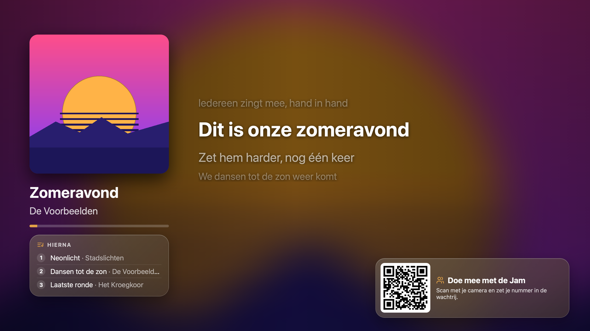
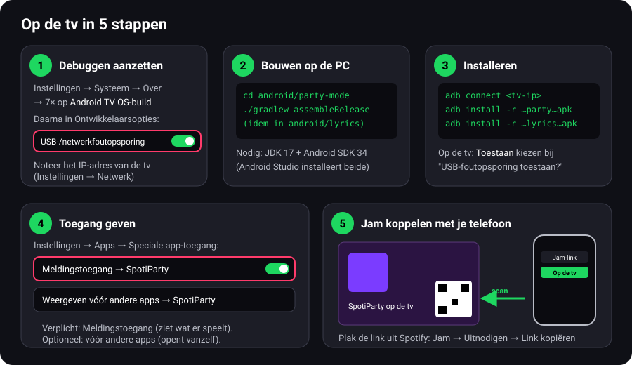
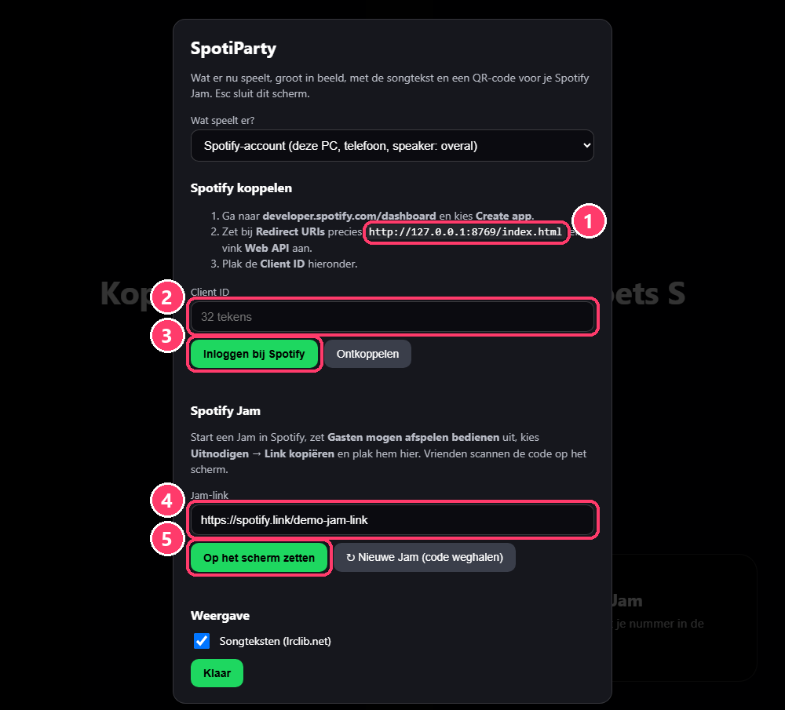
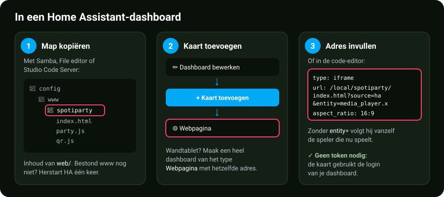

<div align="center">

# 🎉 SpotiParty

**Het nummer dat speelt, groot in beeld: met meelopende songtekst en een QR-code waarmee je vrienden
meedoen met je Spotify Jam.**

## [Website SpotiParty](https://spotiparty.netlify.app/#)

Voor je **Android TV**, je **PC** en je **Home Assistant**-dashboard.



</div>

---

## Inhoud

- [Wat het doet](#-wat-het-doet)
- [Welke versie kies ik?](#-welke-versie-kies-ik)
- [Voorbereiding: je eigen Spotify-app](#-voorbereiding-je-eigen-spotify-app)
- [Installeren op de tv](#-installeren-op-de-tv)
- [Webapp op de PC](#-webapp-op-de-pc)
- [Home Assistant](#-home-assistant)
- [Een Spotify Jam starten](#-een-spotify-jam-starten)
- [Opties en sneltoetsen](#%EF%B8%8F-opties-en-sneltoetsen)
- [Problemen oplossen](#-problemen-oplossen)
- [Privacy](#-privacy)

---

## ✨ Wat het doet


| | |
|---|---|
| **1. Wat er speelt** | De hoes, titel, artiest en voortgang. De hoes ligt wazig over de hele achtergrond en de balk krijgt de kleur van de hoes. Staat de muziek op pauze, dan wordt het nummer gedimd. Is je Spotify gekoppeld, dan zie je ook **Hierna: …** uit de wachtrij. |
| **2. Songtekst** | De regel die gezongen wordt staat groot in het midden en loopt in de maat mee. De teksten komen van [lrclib.net](https://lrclib.net): gratis en zonder account. |
| **3. Jam-QR** | Vrienden scannen de code met hun camera en zetten hun eigen nummers in de wachtrij. Afspelen, overslaan of het volume veranderen kunnen ze niet. |

SpotiParty **leest** alleen van Spotify: wat er speelt en wat erna komt. Hij bedient nooit iets.

---

## 👑 SpotiParty Pro

Het feestscherm is gratis. **Pro** (eenmalig) voegt de **SpotiParty Hub** toe: een admin-dashboard op
`http://<pc-of-pi>:8770` voor al je schermen, met **meldingen**, een **pauze-aftelklok**, een **QR-code voor je
gasten-wifi** en de **Home Assistant-kaart op volledig scherm**. De desktop-app en de Raspberry Pi starten de Hub
vanzelf; de Android TV vindt hem zelf op het netwerk. Zie [docs/pro](docs/pro/README.md).

Nieuw: SpotiParty op een **Raspberry Pi** als vast feestscherm: `sudo ./pi/install.sh`
([docs/raspberry-pi](docs/raspberry-pi/README.md)).

---

## 🧭 Welke versie kies ik?


| | 📺 Android TV | 💻 PC | 🏠 Home Assistant |
|---|---|---|---|
| **Toont** | Wat er op de tv speelt | Wat je Spotify-account speelt, op elk apparaat | Elke `media_player`: Spotify, Sonos, Cast, Music Assistant… |
| **Nodig** | ADB en een PC om te bouwen | De app (`.exe` of `.dmg`), of Python 3 | Home Assistant |
| **Spotify-app nodig?** | Alleen voor **Hierna: …** | Ja | Alleen voor **Hierna: …**, en alleen via HTTPS |
| **Jam-link instellen** | Met je telefoon (QR-code op de tv) | ⚙ in de app | ⚙ in de kaart |
| **Tijd** | ± 20 min | ± 5 min | ± 5 min |

---

## 🔑 Voorbereiding: je eigen Spotify-app

Je hebt een eigen Spotify-app nodig voor de **PC-versie** en, als je dat wilt, voor de regel **Hierna: …** op de tv.
Het maken duurt twee minuten en is gratis. Spotify vraagt dit om te weten welke app je login gebruikt.


1. Ga naar **[developer.spotify.com/dashboard](https://developer.spotify.com/dashboard)**, log in met je eigen
   Spotify-account en kies **Create app**.
2. Vul een naam en een omschrijving in, wat je maar wilt.
3. Zet bij **Redirect URIs** precies het adres voor jouw versie. Wil je beide versies gebruiken, dan voeg je ze allebei toe.

   | Versie | Redirect URI |
   |---|---|
   | PC | `http://127.0.0.1:8769/index.html` |
   | Android TV | `http://127.0.0.1:8768/callback` |
   | Home Assistant via HTTPS | het adres dat de ⚙ van SpotiParty toont, bijv. `https://xxxx.ui.nabu.casa/local/spotiparty/index.html` |

4. Vink **Web API** aan en kies **Save**.
5. Open de app in het dashboard en kopieer de **Client ID**: 32 tekens met cijfers en de letters a tot en met f.

> [!NOTE]
> Een nieuwe Spotify-app staat in *Development mode*. Daarin werkt hij alleen voor accounts die onder
> **User Management** staan. Jouw eigen account staat daar al op. Wil iemand anders inloggen, dan zet je die
> persoon daar ook bij.

---

## 📺 Installeren op de tv

Dit werkt op Android TV en Google TV met Android 8 of nieuwer, zoals Chromecast met Google TV, Sony, Philips,
TCL, Hisense en NVIDIA Shield. Je installeert twee apps: **SpotiParty** zelf en **Lyrics**, een hulpje zonder
eigen scherm dat de songteksten opzoekt.



### Stap 1: Debuggen aanzetten op de tv

1. Ga naar **Instellingen → Systeem → Over** en klik **7 keer** op **Android TV OS-build**. Je ziet daarna
   *"Je bent nu ontwikkelaar"*.
2. Zet in **Instellingen → Systeem → Ontwikkelaarsopties** de optie **USB-foutopsporing** aan, of
   **Netwerkfoutopsporing** als je tv die heeft.
3. Noteer het IP-adres van de tv. Dat vind je onder **Instellingen → Netwerk en internet → je wifi-netwerk**.

### Stap 2: De apps bouwen op je PC

Je hebt **JDK 17** en de **Android SDK** (platform 34) nodig. Installeer je
[Android Studio](https://developer.android.com/studio), dan krijg je beide.

```bash
git clone https://github.com/CodeAura/SpotiParty.git
cd SpotiParty/android/party-mode
./gradlew assembleRelease
cd ../lyrics
./gradlew assembleRelease
cd ../..
```

Op Windows schrijf je `gradlew.bat assembleRelease` in plaats van `./gradlew assembleRelease`.

> [!IMPORTANT]
> Bouw beide apps op **dezelfde PC**. Ze moeten met dezelfde sleutel ondertekend zijn, anders krijgt SpotiParty
> geen songteksten van de Lyrics-app.

### Stap 3: Installeren

```bash
adb connect 192.168.1.50
```

Vervang `192.168.1.50` door het IP-adres van je tv. Op de tv verschijnt **"USB-foutopsporing toestaan?"**: kies
**Toestaan**. Installeer daarna beide apps:

```bash
adb install -r android/party-mode/app/build/outputs/apk/release/app-release.apk
```

```bash
adb install -r android/lyrics/app/build/outputs/apk/release/app-release.apk
```

### Stap 4: Toegang geven

SpotiParty moet kunnen zien wat er speelt. Dat heet in Android **Meldingstoegang**. SpotiParty leest daarbij
geen enkele melding.

**Via de instellingen van de tv:** ga naar **Instellingen → Apps → Speciale app-toegang**.

| Instelling | | Waarvoor |
|---|---|---|
| **Meldingstoegang** → SpotiParty | ✅ verplicht | Zien welk nummer er speelt |
| **Weergeven vóór andere apps** → SpotiParty | ⭕ optioneel | SpotiParty opent vanzelf zodra Spotify begint te spelen |

**Of via ADB:** sommige tv's verstoppen deze schermen. Het eerste commando geeft Meldingstoegang:

```bash
adb shell cmd notification allow_listener io.github.cleanyourtv.partymode/io.github.cleanyourtv.partymode.PartyListener
```

Het tweede commando is optioneel en laat SpotiParty vanzelf openen:

```bash
adb shell appops set io.github.cleanyourtv.partymode SYSTEM_ALERT_WINDOW allow
```

> [!TIP]
> Ben je klaar, zet **USB-/Netwerkfoutopsporing** dan weer uit in de Ontwikkelaarsopties. Zolang dat aan staat,
> kan elk apparaat in je netwerk vragen om de tv te bedienen.

### Stap 5: Openen en de Jam koppelen

1. Open **SpotiParty** op de tv en zet muziek aan in Spotify.
2. Rechtsonder staat de code **Jam instellen**. Scan die met je telefoon. Je telefoon moet op hetzelfde wifi-netwerk zitten.
3. Op de pagina die opent plak je je Jam-link (zie [Een Spotify Jam starten](#-een-spotify-jam-starten)) en tik je
   op **Op de tv zetten**.
4. Op dezelfde telefoonpagina kun je ook:
   - **Spotify koppelen** voor de regel **Hierna: …**. Gebruik de Client ID uit de
     [voorbereiding](#-voorbereiding-je-eigen-spotify-app). Na het inloggen probeert je telefoon `127.0.0.1` te
     openen en lukt dat niet. Dat hoort zo: kopieer het hele adres uit de adresbalk en plak het op de pagina.
   - **Vanzelf openen** aan of uit zetten.

Met **Menu** op de afstandsbediening haal je de instelcode later terug. **↻ Nieuwe Jam** (twee keer OK) haalt
een oude Jam-code weg.

---

## 💻 Webapp op de PC

### Starten met de app (aanbevolen)

Download de app bij de nieuwste [**Release**](../../releases/latest):

| Systeem | Bestand | Installeren |
|---|---|---|
| **Windows 10/11** | `SpotiParty-Setup-1.0.0.exe` | Dubbelklik en volg de stappen. SpotiParty komt in het Startmenu en, als je dat aanvinkt, op je bureaublad. Er zijn geen beheerdersrechten nodig. Verwijderen gaat via **Instellingen → Apps**. |
| **Windows, zonder installatie** | `SpotiParty.exe` | Dubbelklik het bestand. Handig op een USB-stick. |
| **Mac met Apple silicon** (M1 en nieuwer) | `SpotiParty-macos-apple-silicon.dmg` | Open de `.dmg` en sleep **SpotiParty** naar **Apps**. |
| **Mac met Intel** | `SpotiParty-macos-intel.dmg` | Idem. |

SpotiParty opent in een eigen venster, zonder tabbladen. Er verschijnt ook een klein venster met **Scherm openen**
en **Stoppen**. Sluit je dat kleine venster, dan stopt SpotiParty.

> [!WARNING]
> De apps zijn niet bij Microsoft of Apple geregistreerd. Daarom waarschuwt je computer bij de **eerste** start:
> - **Windows:** *"Windows heeft uw pc beschermd"*. Klik **Meer informatie** en dan **Toch uitvoeren**.
> - **Mac:** *"SpotiParty kan niet worden geopend"*. Klik **Gereed** en ga naar **Systeeminstellingen → Privacy en
>   beveiliging**. Klik onderaan bij SpotiParty op **Open toch**.

Daarna start de app gewoon met een dubbelklik.

### Of starten met Python

Heb je [Python 3](https://www.python.org/downloads/)? Op Windows dubbelklik je `web/start.cmd`. Of start hem in een
terminal:

```bash
python web/serve.py
```

Bij beide manieren draait SpotiParty op `http://127.0.0.1:8769/index.html`. Dat luistert alleen op je eigen PC;
niemand anders in het netwerk kan erbij.

### Instellen

De eerste keer opent het instellingenscherm vanzelf. Later open je het met **S**, of met de ⚙ die verschijnt
zodra je de muis beweegt.



| # | Wat je doet |
|---|---|
| **1** | Dit adres zet je als **Redirect URI** in je Spotify-app (zie [voorbereiding](#-voorbereiding-je-eigen-spotify-app)). |
| **2** | Plak de **Client ID** van je Spotify-app. |
| **3** | Klik **Inloggen bij Spotify**. Er opent een venster: log in en kies **Akkoord**. Het venster sluit vanzelf. |
| **4** | Plak de **Jam-link** (zie [Een Spotify Jam starten](#-een-spotify-jam-starten)). |
| **5** | Klik **Op het scherm zetten**. De QR-code staat nu rechtsonder. |

Druk op **F** voor volledig scherm. De muisaanwijzer verdwijnt vanzelf na 2,5 seconde. Sluit je de app op een
tweede scherm of beamer aan, dan heb je zo een feestscherm.

---

## 🏠 Home Assistant

SpotiParty past als kaart in elk dashboard en volgt elke `media_player`, dus niet alleen Spotify.



### Stap 1: Bestanden kopiëren

Kopieer de inhoud van de map **`web/`** naar **`/config/www/spotiparty/`** in Home Assistant. Dat kan met de
add-on **Samba share**, **File editor** of **Studio Code Server**. Bestond de map `www` nog niet? Herstart Home
Assistant dan één keer.

### Stap 2: Kaart toevoegen

Open je dashboard en kies **✏️ Dashboard bewerken → + Kaart toevoegen → Webpagina**.

### Stap 3: Adres invullen

Vul bij de kaart als URL in:

```text
/local/spotiparty/index.html?source=ha&entity=media_player.woonkamer
```

Vervang `media_player.woonkamer` door je eigen speler. Laat je `&entity=…` weg, dan volgt SpotiParty vanzelf
de speler die op dat moment speelt.

Of plak dit in de **code-editor** van de kaart:

```yaml
type: iframe
url: /local/spotiparty/index.html?source=ha&entity=media_player.woonkamer
aspect_ratio: 16:9
```

<table><tr>
<td></td>
<td>

**Werkt meteen, zonder token.** De kaart wordt door je eigen Home Assistant geserveerd en leest de standen van
je dashboard.

**Smalle kaart?** Dan zet SpotiParty alles onder elkaar, zoals links.

**Wandtablet of tv-browser?** Maak een heel dashboard van het type **Webpagina** met hetzelfde adres en
`&kiosk=1` erachter.

**Jam-link?** Klik in de kaart en druk op **S**, of beweeg de muis en klik op ⚙.

</td>
</tr></table>

### Optioneel

- **Hierna: … in Home Assistant.** Spotify accepteert alleen `https://`-adressen om na het inloggen naar terug te
  gaan, plus `http://127.0.0.1`. Open je Home Assistant via HTTPS, bijvoorbeeld met Nabu Casa of een eigen
  certificaat? Zet dan het adres dat de ⚙ toont als Redirect URI in je Spotify-app.
- **Vanaf een andere computer.** Open SpotiParty op die PC en kies in de ⚙ **Home Assistant media player**. Vul het
  adres van Home Assistant in en een **Long-lived access token**: je profiel → **Beveiliging** → onderaan
  **Token aanmaken**.

---

## 🎶 Een Spotify Jam starten

Met een Jam zetten je vrienden nummers in jouw wachtrij, vanaf hun eigen telefoon.

1. Open Spotify op je telefoon en zet muziek aan op je tv, PC of speaker.
2. Tik op het **apparaat-icoon** of de **drie puntjes** en kies **Start een Jam**.
3. Zet in de **Jam-instellingen** de optie **Gasten mogen afspelen bedienen** uit. Dan kunnen vrienden alleen
   nummers toevoegen: niet overslaan, pauzeren of het volume veranderen.
4. Tik op **Uitnodigen → Link kopiëren** en plak de link in SpotiParty.

Stopt de Jam, dan werkt de oude link niet meer. Start dan een nieuwe Jam en plak de nieuwe link.

---

## ⌨️ Opties en sneltoetsen

| Toets (PC / HA) | Wat het doet |
|---|---|
| **S** of **M** | Instellingen openen of sluiten |
| **F** | Volledig scherm |
| **Esc** | Instellingen sluiten |

| Toevoeging aan de URL | Wat het doet |
|---|---|
| `?source=ha` / `?source=spotify` | De bron kiezen zonder de instellingen te openen |
| `&entity=media_player.x` | De Home Assistant-speler die SpotiParty volgt |
| `&kiosk=1` | Geen knoppen in beeld (**S** werkt nog wel) |
| `&jam=0` | De Jam-QR-code niet tonen |

---

## 🛠 Problemen oplossen

| Probleem | Oplossing |
|---|---|
| **Tv:** *"SpotiParty mag nog niet zien wat er speelt"* | Zet **Meldingstoegang** aan (stap 4 van de tv-installatie). |
| **Tv:** geen songtekst, *"Installeer de Lyrics-add-on"* | Installeer de Lyrics-app, gebouwd op dezelfde PC als SpotiParty. |
| *"Geen songtekst voor dit nummer"* | lrclib.net heeft dit nummer niet. Bij heel nieuwe of onbekende nummers komt dat voor. |
| Spotify: *"INVALID_CLIENT: Invalid redirect URI"* | De Redirect URI in je Spotify-app wijkt een teken af. Kopieer hem precies uit de ⚙. |
| Spotify: *"geen toegang"* of *"forbidden"* | Zet het account onder **User Management** van je Spotify-app. |
| **Hierna: …** blijft leeg | De wachtrij is leeg, of een ander account speelt dan het account dat je gekoppeld hebt. |
| **HA:** de kaart blijft *"Zet muziek aan"* | Geen speler met een titel speelt. Kies een vaste speler met `&entity=`. |
| **HA:** *"token nodig"* | De pagina draait niet via `/local/` van je eigen Home Assistant. Vul een access token in via de ⚙. |
| **PC:** de knop *Inloggen* is grijs | Open de app via `http://127.0.0.1:8769` (de app of `serve.py`), niet als bestand of via een ander `http://`-adres. |
| **PC:** de app opent niets | Draait SpotiParty al, of gebruikt een ander programma poort 8769? Sluit het andere programma of de oude SpotiParty. |
| **Tv:** de QR-code voor je telefoon werkt niet | Je telefoon moet op hetzelfde wifi-netwerk zitten als de tv. |

---

## 🔒 Privacy

- **Geen eigen server.** Er is geen account, geen statistieken en geen tracking.
- **Je gegevens blijven op je apparaat.** Je Spotify-login, de Jam-link en je instellingen staan alleen op het
  apparaat zelf: de tv, of de browser van je PC.
- **Spotify:** SpotiParty vraagt alleen de leesrechten *user-read-playback-state* en *user-read-currently-playing*.
- **lrclib.net:** krijgt alleen de artiest, de titel, het album en de lengte van het nummer, om de songtekst op te
  zoeken.
- **De telefoonpagina van de tv:** draait alleen in je eigen netwerk, en alleen zolang SpotiParty open is.

---

## Herkomst en licentie

SpotiParty begon als add-on voor de [CleanYourTV](https://github.com/Gathin23/cleanyourtv)-launcher. De
pakketnamen (`io.github.cleanyourtv.*`) zijn daarom hetzelfde gebleven. Gebruik je die launcher, dan verschijnt
SpotiParty daar als kaart, en leveren de songteksten ook *Now playing* in de launcher.

SpotiParty heeft niets met Spotify AB te maken. Spotify is een handelsmerk van Spotify AB.

Uitgegeven onder de [MIT-licentie](LICENSE).
