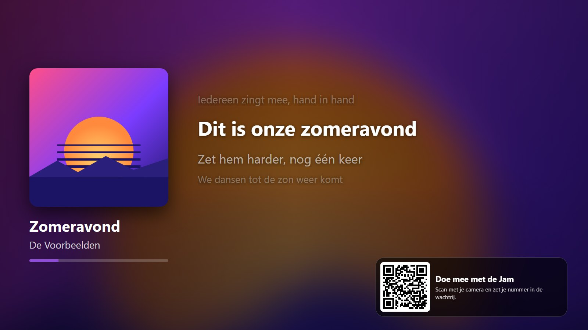

# Welkom bij SpotiParty

**SpotiParty** maakt van je tv, PC of Home Assistant-dashboard een feestscherm. Je ziet de hoes van het nummer dat speelt, de songtekst loopt in de maat mee, en met een QR-code doen je vrienden mee met je **Spotify Jam**.

## Wat zie je op het scherm?

|                      |                                                                                                                                                                                                                                                         |
| -------------------- | ------------------------------------------------------------------------------------------------------------------------------------------------------------------------------------------------------------------------------------------------------- |
| **1. Wat er speelt** | De hoes, titel, artiest en voortgang. De hoes ligt wazig over de hele achtergrond en de balk krijgt de kleur van de hoes. Staat de muziek op pauze, dan wordt het nummer gedimd. Is je Spotify gekoppeld, dan zie je ook **Hierna: …** uit de wachtrij. |
| **2. Songtekst**     | De regel die gezongen wordt staat groot in het midden en loopt in de maat mee. De teksten komen van [lrclib.net](https://lrclib.net): gratis en zonder account.                                                                                         |
| **3. Jam-QR**        | Vrienden scannen de code met hun camera en zetten hun eigen nummers in de wachtrij.                                                                                                                                                                     |

SpotiParty **leest** alleen van Spotify: wat er speelt en wat erna komt. Hij bedient nooit iets.

## Kies waar je SpotiParty wilt installeren

<table data-view="cards"><thead><tr><th></th><th></th><th data-hidden data-card-target data-type="content-ref"></th></tr></thead><tbody><tr><td><strong>📺 Android TV</strong></td><td>Op je Android TV of Google TV. Volgt wat er op de tv speelt. ± 20 minuten.</td><td><a href="android-tv/">android-tv</a></td></tr><tr><td><strong>💻 PC</strong></td><td>Windows, Mac of Linux. Volgt je Spotify-account, waar de muziek ook speelt. ± 5 minuten.</td><td><a href="pc/">pc</a></td></tr><tr><td><strong>🏠 Home Assistant</strong></td><td>Als kaart in je dashboard. Volgt elke mediaspeler. ± 5 minuten.</td><td><a href="home-assistant/">home-assistant</a></td></tr></tbody></table>

Weet je nog niet welke versie bij je past? Lees eerst [Aan de slag](aan-de-slag/).

## Snel naar

* [Je eigen Spotify-app maken](aan-de-slag/spotify-app.md): nodig voor de PC-versie en voor de regel _Hierna_
* [Een Spotify Jam starten](aan-de-slag/spotify-jam.md)
* [Sneltoetsen en URL-opties](gebruik/sneltoetsen-en-url-opties.md)
* [Problemen oplossen](hulp/problemen-oplossen.md)


SpotiParty is gratis en open source onder de MIT-licentie. Er is geen eigen server, geen account en geen tracking. Zie [Privacy](hulp/privacy.md).

