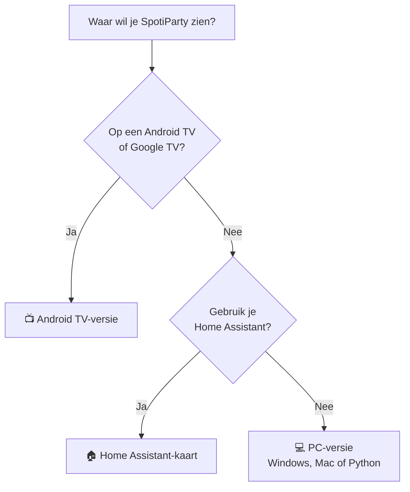

# Aan de slag

SpotiParty bestaat in drie smaken. Ze laten allemaal hetzelfde feestscherm zien, maar halen hun informatie op een andere plek vandaan. Welke je kiest, hangt vooral af van **waar de muziek speelt** en **op welk scherm** je SpotiParty wilt zien.

## Welke versie kies ik?

|                              | 📺 Android TV                            | 💻 PC                                                   | 🏠 Home Assistant                                           |
| ---------------------------- | ---------------------------------------- | ------------------------------------------------------- | ----------------------------------------------------------- |
| **Toont**                    | Wat er in de Spotify-app óp de tv speelt | Wat je Spotify-account speelt, op welk apparaat dan ook | Elke `media_player`: Spotify, Sonos, Cast, Music Assistant… |
| **Nodig**                    | Een PC om te bouwen, plus ADB            | De app (`.exe` of `.dmg`), of Python 3                  | Een werkende Home Assistant                                 |
| **Eigen Spotify-app nodig?** | Alleen voor de regel **Hierna: …**       | Ja                                                      | Alleen voor **Hierna: …**, en alleen via HTTPS              |
| **Jam-link instellen**       | Met je telefoon (QR-code op de tv)       | Via ⚙ in de app                                         | Via ⚙ in de kaart                                           |
| **Tijd**                     | ± 20 minuten                             | ± 5 minuten                                             | ± 5 minuten                                                 |


**Twijfel je?** Begin met de PC-versie. Die heb je in vijf minuten draaiend, en met een HDMI-kabel naar je tv of beamer heb je meteen een feestscherm.


## Wat heb je in elk geval nodig?

* **Spotify Premium** als je een Jam wilt starten. Gasten met een gratis account kunnen wel meedoen en nummers toevoegen.
* **Spotify Premium** ook als je een eigen Spotify-app maakt (voor de PC-versie verplicht). Dat is sinds februari 2026 een regel van Spotify, zie [Je eigen Spotify-app maken](spotify-app.md).
* Een internetverbinding: de songteksten komen van [lrclib.net](https://lrclib.net).

## De volgorde die we aanraden

1. Maak eerst [je eigen Spotify-app](spotify-app.md). Voor de PC-versie is dat verplicht, voor de andere twee optioneel.
2. Volg de installatie voor jouw versie: [Android TV](../android-tv/), [PC](../pc/) of [Home Assistant](../home-assistant/).
3. [Start een Spotify Jam](spotify-jam.md) en plak de link in SpotiParty.
