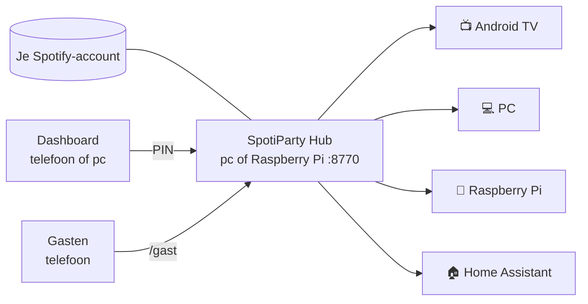

# Aan de slag

SpotiParty bestaat uit twee delen:

* **De Hub**: een klein programma op je pc of Raspberry Pi. Daar koppel je één keer je Spotify-account en je Jam-link, en vandaar bestuur je alle schermen. De Windows-app en de Pi starten hem vanzelf.
* **De schermen**: een Android TV, een pc, een Raspberry Pi of een kaart in Home Assistant. Ze melden zich vanzelf bij de Hub en laten allemaal hetzelfde feestscherm zien.

## Welke schermen kies ik?

|                     | 💻 PC                                   | 🍓 Raspberry Pi                         | 📺 Android TV                                   | 🏠 Home Assistant                                    |
| ------------------- | --------------------------------------- | --------------------------------------- | ----------------------------------------------- | ---------------------------------------------------- |
| **Rol**             | Scherm **en** Hub                       | Scherm en/of Hub                        | Scherm                                          | Scherm (kaart)                                       |
| **Toont**           | Je Spotify-account, via de Hub          | Je Spotify-account, via de Hub          | Wat er op de tv speelt, of je account via de Hub | Elke `media_player`, of je account via de Hub       |
| **Nodig**           | Windows 10/11, of Python 3 (Mac/Linux)  | Raspberry Pi OS (64-bit) met desktop    | Een PC om te bouwen, plus ADB                   | Home Assistant, liefst met HACS                      |
| **Updates**         | Vanzelf (Windows, vanaf 2.7.0)          | `sudo ./pi/install.sh` opnieuw          | Opnieuw bouwen en installeren                   | Via HACS                                             |
| **Tijd**            | ± 5 minuten                             | ± 10 minuten                            | ± 20 minuten                                    | ± 5 minuten                                          |


**Twijfel je?** Begin met de [Windows-app](../pc/windows.md). Die heb je in vijf minuten draaiend, met de Hub erbij, en met een HDMI-kabel naar je tv of beamer heb je meteen een feestscherm. Andere schermen voeg je later toe.


## Wat heb je in elk geval nodig?

* **Spotify Premium** als je een Jam wilt starten. Gasten met een gratis account kunnen wel meedoen en nummers toevoegen.
* **Spotify Premium** ook voor je eigen Spotify-app, waarmee je je account aan de Hub koppelt. Dat is sinds februari 2026 een regel van Spotify, zie [Je eigen Spotify-app maken](spotify-app.md).
* Een **thuisnetwerk** waarop de Hub, de schermen en de telefoons van je gasten elkaar kunnen bereiken.
* Een internetverbinding: de songteksten komen van [lrclib.net](https://lrclib.net).

## De volgorde die we aanraden

1. Installeer de Hub: de [Windows-app](../pc/windows.md) of een [Raspberry Pi](../raspberry-pi/README.md).
2. Maak [je eigen Spotify-app](spotify-app.md) en koppel je account in het [Hub-dashboard](../hub/hub-dashboard.md).
3. [Start een Spotify Jam](spotify-jam.md) en plak de link in het dashboard.
4. Voeg schermen toe: [Android TV](../android-tv/), [Home Assistant](../home-assistant/) of een tweede pc.
5. Zet eventueel de [feestspellen](../hub/feestspellen.md) aan.
