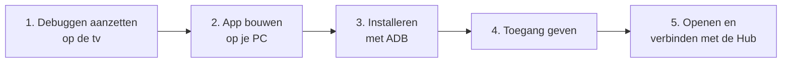

# Android TV

Op de tv toont SpotiParty **hetzelfde scherm als de webapp**: de app laadt het rechtstreeks van je
[SpotiParty Hub](../hub/hub-dashboard.md) (`http://<hub>:8770/scherm/`). Daardoor is de tv altijd net zo nieuw als de
Hub: werkt de Hub zichzelf bij, dan heeft de tv bij het volgende openen de nieuwe versie. De app zelf hoef je daarvoor
niet opnieuw te installeren.

De app staat niet in de Play Store. Je bouwt hem zelf op je PC en zet hem via ADB (Android Debug Bridge) op de tv.
Reken op ongeveer een kwartier.

## Werkt het op mijn tv?

SpotiParty werkt op **Android TV en Google TV met Android 8.0 of nieuwer**. Denk aan Chromecast met Google TV, tv's van
Sony, Philips, TCL en Hisense, en de NVIDIA Shield.

## Wat heb je nodig?

|                                                |                                                                                            |
| ---------------------------------------------- | ------------------------------------------------------------------------------------------ |
| **Een SpotiParty Hub**                         | Op je pc, Mac, Raspberry Pi of [server](../hub/linux-server.md): het scherm komt daarvandaan |
| **Een PC** (Windows, Mac of Linux)             | Om de app te bouwen en te installeren                                                      |
| **JDK 17** en de **Android SDK** (platform 34) | Krijg je allebei als je [Android Studio](https://developer.android.com/studio) installeert |
| **ADB**                                        | Zit in de Android SDK (_platform-tools_)                                                   |
| **Hetzelfde netwerk**                          | Voor de tv en de Hub                                                                       |

## Het stappenplan in één oogopslag


Had je een oudere versie met de aparte **Lyrics**-app? Die is niet meer nodig: de songteksten haalt het scherm nu zelf
op bij [lrclib.net](https://lrclib.net). Verwijder hem met `adb uninstall io.github.cleanyourtv.lyrics`.


Begin bij [Stap 1: Debuggen aanzetten](stap-1-debuggen.md).
