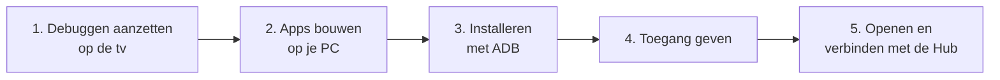

# Android TV

Op de tv laat SpotiParty zien wat er op die tv speelt, of het nummer van het Spotify-account dat je aan de [Hub](../hub/hub-dashboard.md) hebt gekoppeld. Je installeert twee apps:

* **SpotiParty**: het feestscherm zelf.
* **Lyrics**: een hulpje zonder eigen scherm dat de songteksten opzoekt bij [lrclib.net](https://lrclib.net).

De apps staan niet in de Play Store. Je bouwt ze zelf op je PC en zet ze via ADB (Android Debug Bridge) op de tv. Dat klinkt technischer dan het is: reken op ongeveer twintig minuten.

## Werkt het op mijn tv?

SpotiParty werkt op **Android TV en Google TV met Android 8.0 of nieuwer**. Denk aan Chromecast met Google TV, tv's van Sony, Philips, TCL en Hisense, en de NVIDIA Shield.

## Wat heb je nodig?

|                                                |                                                                                                      |
| ---------------------------------------------- | ---------------------------------------------------------------------------------------------------- |
| **Een PC** (Windows, Mac of Linux)             | Om de apps te bouwen en te installeren                                                               |
| **JDK 17** en de **Android SDK** (platform 34) | Krijg je allebei als je [Android Studio](https://developer.android.com/studio) installeert           |
| **ADB**                                        | Zit in de Android SDK (_platform-tools_)                                                             |
| **Hetzelfde wifi-netwerk**                     | Voor je PC, je tv en je telefoon                                                                     |
| **Aanbevolen: een SpotiParty Hub**             | Voor de Jam-link, de komende nummers, meldingen en de feestspellen (zie [Hub](../hub/hub-dashboard.md)) |

## Het stappenplan in één oogopslag


**Bouw beide apps op dezelfde PC.** SpotiParty en Lyrics moeten met dezelfde sleutel ondertekend zijn. Anders weigert Android dat SpotiParty de songteksten van Lyrics leest. Liever niet zelf bouwen? De workflow **Android TV apps** onder [Actions](https://github.com/CodeAura/SpotiParty/actions) maakt beide APK's met dezelfde sleutel.


Begin bij [Stap 1: Debuggen aanzetten](stap-1-debuggen.md).
