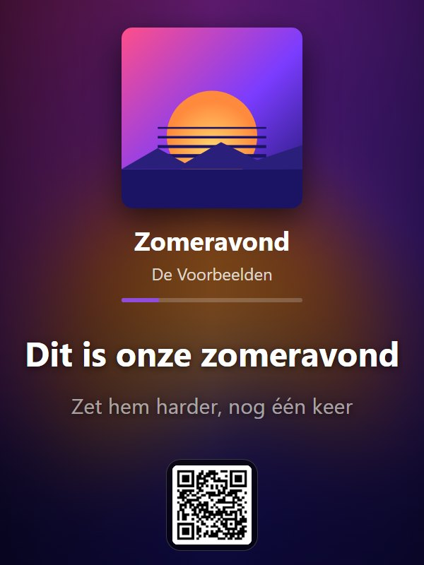

# Gebruik

SpotiParty past zich vanzelf aan het scherm aan. Op een breed scherm staat de hoes links, de songtekst in het midden en de QR-code rechtsonder. Op een smal scherm, zoals een kaart in Home Assistant of een tablet in staande stand, zet SpotiParty alles onder elkaar.

## Wat er gebeurt

* **Nieuw nummer:** de hoes, de achtergrond en de kleur van de voortgangsbalk wisselen mee. De songtekst wordt opgezocht en daarna in het geheugen bewaard.
* **Pauze:** het nummer wordt gedimd, zodat je ziet dat de muziek stilstaat.
* **Geen songtekst gevonden:** je ziet _Geen songtekst voor dit nummer_. De hoes en titel blijven gewoon in beeld.
* **Niets speelt:** SpotiParty vraagt je om muziek aan te zetten.

Alle toetsen en instellingen vind je bij [Sneltoetsen en URL-opties](sneltoetsen-en-url-opties.md).
