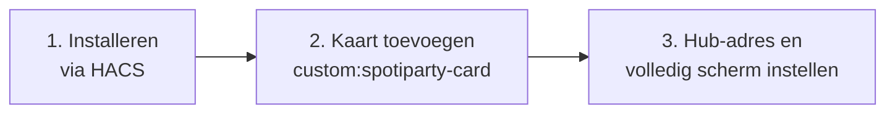

# Home Assistant

In Home Assistant wordt SpotiParty een kaart in je dashboard: als gewone kaart, of over het hele scherm voor een wandtablet of een tv met je dashboard. De kaart volgt **elke `media_player`** (Spotify, Sonos, Google Cast, Music Assistant…) en toont met de [Hub](../hub/hub-dashboard.md) het nummer van je Spotify-account, met songtekst, Jam-code, meldingen en de pauze.

## Wat heb je nodig?

* Een werkende **Home Assistant**, die je thuis opent via `http://` (bijvoorbeeld `http://homeassistant.local:8123`).
* **[HACS](https://hacs.xyz)**: dan installeer je SpotiParty in één klik en krijg je updates vanzelf. Zonder HACS kan het ook, met één bestand.
* De **SpotiParty Hub** op een pc in je netwerk (de [Windows- of Mac-app](../pc/)). Spotify koppel je één keer in het dashboard van de Hub; de kaart zelf heeft geen Spotify-login nodig.

Een token of een eigen Spotify-app is voor de kaart **niet** nodig: hij leest de spelers uit je eigen dashboard.

## In drie stappen

1. [Installeren via HACS (of met de hand)](bestanden-kopieren.md)
2. [Kaart toevoegen](kaart-toevoegen.md)
3. [Volledig scherm en alle opties](volledig-scherm.md)

Daarna: [Extra's en problemen oplossen](extras.md).


De songteksten komen van [lrclib.net](https://lrclib.net). Home Assistant hoeft daarvoor niets te doen: de browser die het dashboard toont, haalt ze zelf op.

