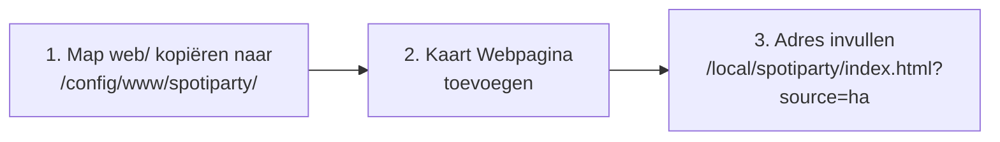

# Home Assistant

In Home Assistant wordt SpotiParty een kaart in je dashboard. Het mooie: de kaart volgt **elke `media_player`**, dus niet alleen Spotify. Sonos, Google Cast, Music Assistant: zolang de speler een titel doorgeeft, toont SpotiParty de hoes en zoekt hij de songtekst erbij.

## Wat heb je nodig?

* Een werkende **Home Assistant**.
* Een manier om bestanden in de map `/config` te zetten, bijvoorbeeld de add-on **Samba share**, **File editor** of **Studio Code Server**.
* De map **`web/`** uit SpotiParty (`index.html`, `party.js`, `qr.js` en de rest).

Een token of een eigen Spotify-app is **niet** nodig. De kaart wordt door je eigen Home Assistant geserveerd en leest de standen van je dashboard.

## In drie stappen

1. [Bestanden kopiëren](bestanden-kopieren.md)
2. [Kaart toevoegen](kaart-toevoegen.md)
3. [Extra's: kiosk, Hierna en andere computers](extras.md)


De songteksten komen van [lrclib.net](https://lrclib.net). Je Home Assistant hoeft daarvoor niets te doen: de browser die het dashboard toont, haalt ze zelf op.

