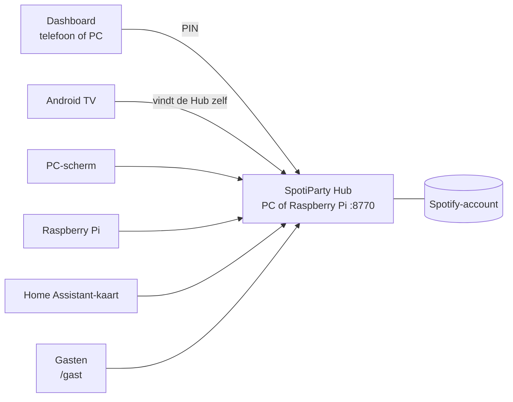

# Hub en admin-dashboard

De **SpotiParty Hub** is een klein programma op je PC of Raspberry Pi. Alle schermen op je netwerk melden zich daar. Vanaf het dashboard koppel je Spotify, zet je de Jam-link op alle schermen, bedien je de muziek, start je de feestspellen en stuur je meldingen, een pauze en de gasten-wifi naar je schermen.

## De Hub starten

| Waar | Hoe |
| --- | --- |
| **Desktop-app** (Windows, Mac, of `desktop/spotiparty_app.py`) | Start vanzelf. Klik op **Dashboard** in het venster: de eerste keer kies je daar je PIN. Daarna toont het venster het adres en de **PIN**. Er draait één Hub per netwerk: een tweede pc wordt een scherm van de eerste. |
| **Raspberry Pi** | `sudo ./pi/install.sh` zet hem als dienst neer. Zie [Raspberry Pi](../raspberry-pi/README.md). |
| **Python** | `python3 hub/spotiparty_hub.py`: het adres staat in de terminal; de eerste keer kies je de PIN op `http://127.0.0.1:8770` op die computer. |

Open daarna het dashboard op `http://<adres-van-die-computer>:8770`, ook op je telefoon, en vul de PIN in.

### De eerste keer: kies je PIN

* **Een nieuwe Hub** heeft nog geen PIN. Open je het dashboard, dan krijg je **Welkom bij je Hub**: kies een PIN van 4 tot 12 cijfers en vul hem nog een keer in. Makkelijk te raden PIN's zoals `0000` of `1234` gaan niet.
* **Desktop-app:** dat kan alleen op de computer waar SpotiParty draait (via **Dashboard** in het venster). Opent iemand het dashboard eerst op een telefoon, dan staat daar dat de PIN op die computer gekozen moet worden. Zo kan niemand anders op je wifi je voor zijn met een eigen PIN.
* **Raspberry Pi en server:** die hebben geen eigen scherm, dus daar kies je de PIN vanaf elk apparaat in je netwerk. Doe dat meteen na het installeren.
* **Een oudere Hub** met een PIN die hij zelf bedacht (de desktop-app of een Raspberry Pi van vóór 3.6.0): na het inloggen vraagt het dashboard één keer om een eigen PIN. Kies er een (twee keer invullen) of klik op **Huidige PIN houden**.
* **Later wijzigen** doe je bij **Hub**: vul de nieuwe PIN twee keer in en klik op **Opslaan**.

## Hoe het dashboard is ingedeeld

Bovenaan staan de **Schermen**, daaronder **Aan de slag** zolang er nog iets te doen is. Op een PC staan daarna
**Muziek bedienen**, **Spotify Jam** en **Melding op het scherm** naast elkaar, en daaronder **Feest** (twee kolommen breed)
met rechts **Korte pauze**, **Gasten-wifi** en **Hub**. Op een tablet zijn het twee kolommen, op een telefoon één.

## De eerste keer: uitleg en "Aan de slag"

* **Rondleiding:** de eerste keer dat je het dashboard opent, loopt een korte uitleg langs alle onderdelen. Het onderdeel waar het over gaat licht op, de rest wordt donker. Klik op **Volgende** (of gebruik de pijltjestoetsen), of op **Tutorial overslaan** om meteen te beginnen. Terugzien kan altijd met **Uitleg** rechtsboven.
* **Aan de slag:** bovenaan staat wat er nog moet gebeuren voor een werkend feest: Spotify koppelen, een scherm verbinden, de Jam-link en iets voor je gasten aanzetten. Met de knop bij een stap ga je meteen naar de goede plek. Is alles klaar, of klik je op **Verbergen**, dan verdwijnt de lijst.
* **Snel naar een onderdeel:** met de links in de kop (Schermen, Muziek, Jam, Melding, Feest, Pauze, Wifi, Hub).

Of je de uitleg al hebt gezien, onthoudt elke browser zelf: op je telefoon zie je hem dus ook één keer.


**Windows** vraagt de eerste keer of SpotiParty op het netwerk mag. Kies **Privénetwerken**, anders kunnen de tv en je telefoon de Hub niet bereiken.


## Schermen koppelen

| Scherm | Koppelen |
| --- | --- |
| **Android TV** | Vanzelf: de tv zoekt de Hub op het netwerk. Lukt dat niet (sommige routers blokkeren dat), vul dan het adres in op de instelpagina op je telefoon onder **SpotiParty Hub**. Daar geef je de tv ook een naam. |
| **PC-scherm** | Vanzelf als de Hub op dezelfde PC draait (de desktop-app). Anders: ⚙ → **SpotiParty Hub** → adres. |
| **Raspberry Pi** | Vanzelf; met een Hub op een andere computer: `sudo ./pi/install.sh --hub 192.168.1.20`. |
| **Home Assistant** | `hub: http://192.168.1.20:8770` in de [SpotiParty-kaart](../home-assistant/volledig-scherm.md), of `&hub=…` achter het adres van de Webpagina-kaart. |


Een scherm dat via **https://** draait (bijvoorbeeld Home Assistant via Nabu Casa) mag de Hub op `http://` niet bereiken: dat blokkeert de browser. Open Home Assistant op dat scherm via het lokale `http://`-adres.


## Eerst: Spotify en de Jam

1. **🎵 Muziek bedienen**: plak de **Client ID** van je [Spotify-app](../aan-de-slag/spotify-app.md) en klik **Inloggen bij Spotify**. In je Spotify-app moet de Redirect URI `http://127.0.0.1:8770/spotify/callback` staan (het dashboard toont hem). Log je in op je telefoon, dan opent `127.0.0.1` daarna niet: kopieer het hele adres uit de adresbalk, plak het in het dashboard en klik **Koppelen**.
2. **🎶 Spotify Jam**: plak de link van je [Jam](../aan-de-slag/spotify-jam.md) en klik **Op alle schermen**. Met **Weghalen** haal je hem van alle schermen.

## In het dashboard

* **📺 Schermen**: groen = online. **Aanwijzen** zet de naam groot op dat scherm, zodat je weet welke het is. **Naam** geeft het een eigen naam.
* **🎵 Muziek bedienen**: wat er speelt en op welk apparaat, met 🔉 ⏮ ⏯ ⏭ 🔊. Werkt op welk apparaat je account ook speelt. Met **Dit account ontkoppelen** haal je het actieve account weg.

## Meerdere Spotify-accounts

Draaien jij en je huisgenoot of partner allebei muziek? Koppel dan meerdere accounts aan de Hub en wissel met één tik.

1. Zet het tweede account in je Spotify-app op [developer.spotify.com/dashboard](https://developer.spotify.com/dashboard) onder **User Management**. Zolang de app in *Development Mode* staat, mogen er vijf accounts in.
2. Klik in het dashboard bij **Muziek bedienen** op **+ Account** en log in met dat account. Zit je browser nog op het eerste account, log dan eerst uit op spotify.com.
3. Bovenaan **Muziek bedienen** staat nu een rij met de accounts. Het actieve account (groen omrand) bepaalt wat alle schermen tonen en wat de knoppen bedienen. Tik op een ander account om te wisselen. Speelt het actieve account, dan staat er een luidsprekertje bij.

De Hub wisselt nooit zelf: alleen jij kiest welk account actief is. Speelt er op een ander account muziek, dan verandert er op de schermen niets tot je in het dashboard op dat account tikt.

Logt hetzelfde account nog eens in, dan krijgt het alleen een nieuwe koppeling; er komt geen tweede bij. Verloopt de koppeling van één account, dan verdwijnt alleen dat account uit de rij.
* **🎉 Feest**: hoeveel komende nummers de schermen tonen, 👎 Skip-stemmen en 🎤 _Raad het nummer_, met de QR-code van de gastenpagina. Zie [Feestspellen](feestspellen.md).
* **💬 Melding**: kies een stijl (gewoon, feest, belangrijk), hoe lang hij blijft staan en op welke schermen.
* **⏸️ Korte pauze**: kies het aantal minuten en eventueel een eigen tekst. Met **+5 min** verleng je, met **Stoppen** haal je de klok weg. Staat **Muziek pauzeren, en na afloop weer aanzetten** aan (standaard), dan doet de Hub dat via je Spotify-account.
* **📶 Gasten-wifi**: netwerknaam en wachtwoord, en **QR-code op de schermen tonen**. Gebruik een apart gastennetwerk: iedereen die het scherm ziet, kan het wachtwoord lezen.
* **⚙️ Hub**: de naam van de Hub en een eigen PIN.

## Veiligheid

* Alles wat iets verandert, vraagt de PIN. Na vijf foute pogingen wacht de Hub een minuut.
* Schermen lezen alleen. Gasten kunnen op de gastenpagina alleen stemmen, raden en de Jam-link zien.
* De Hub draait alleen op je eigen netwerk; zet poort 8770 niet open in je router.
