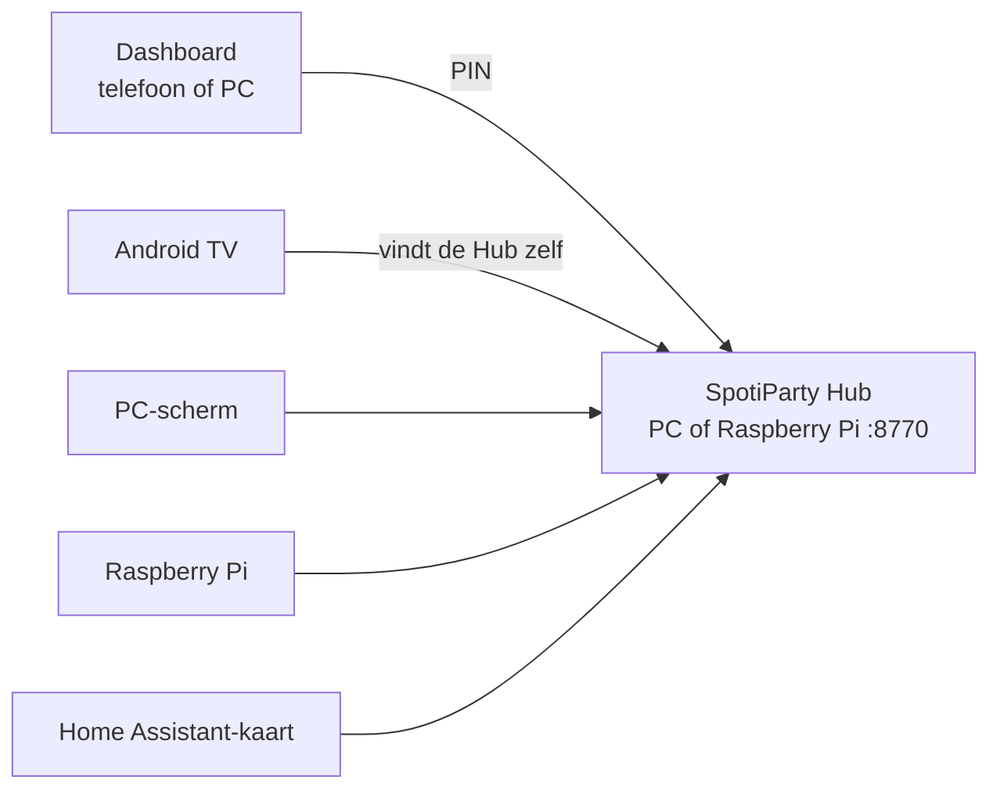

# Hub en admin-dashboard

De **SpotiParty Hub** is een klein programma op je PC of Raspberry Pi. Alle schermen op je netwerk melden zich daar, en vanaf het dashboard stuur je meldingen, een pauze en de gasten-wifi naar die schermen.

## De Hub starten

| Waar | Hoe |
| --- | --- |
| **Desktop-app** (Windows/Mac) | Start vanzelf. Het venster toont het adres en de **PIN**, en heeft een knop **Dashboard**. |
| **Raspberry Pi** | `sudo ./pi/install.sh` zet hem als dienst neer. Zie [Raspberry Pi](../raspberry-pi/README.md). |
| **Python** | `python3 hub/spotiparty_hub.py` (adres en PIN staan in de terminal). |

Open daarna het dashboard op `http://<adres-van-die-computer>:8770`, ook op je telefoon, en vul de PIN in.


**Windows** vraagt de eerste keer of SpotiParty op het netwerk mag. Kies **Privénetwerken**, anders kunnen de tv en je telefoon de Hub niet bereiken.


## Schermen koppelen

| Scherm | Koppelen |
| --- | --- |
| **Android TV** | Vanzelf: de tv zoekt de Hub op het netwerk. Lukt dat niet (sommige routers blokkeren dat), vul dan het adres in op de instelpagina op je telefoon onder **SpotiParty Hub**. Daar geef je de tv ook een naam. |
| **PC-scherm** | Vanzelf als de Hub op dezelfde PC draait (de desktop-app). Anders: ⚙ → **SpotiParty Hub** → adres. |
| **Raspberry Pi** | Vanzelf; met een Hub op een andere computer: `sudo ./pi/install.sh --hub 192.168.1.20`. |
| **Home Assistant** | `hub: http://192.168.1.20:8770` in de [SpotiParty-kaart](../home-assistant/volledig-scherm.md), of `&hub=…` achter het adres van de Webpagina-kaart. |


Een scherm dat via **https://** draait (bijvoorbeeld Home Assistant via Nabu Casa) mag de Hub op `http://` niet bereiken: dat blokkeert de browser. Open Home Assistant op dat scherm via het lokale `http://`-adres.


## In het dashboard

* **📺 Schermen**: groen = online. **Aanwijzen** zet de naam groot op dat scherm, zodat je weet welke het is. **Naam** geeft het een eigen naam.
* **💬 Melding**: kies een stijl (gewoon, feest, belangrijk), hoe lang hij blijft staan en op welke schermen.
* **⏸️ Korte pauze**: kies het aantal minuten. Met **+5 min** verleng je, met **Stoppen** haal je de klok weg. De muziek bedien je zelf: SpotiParty pauzeert of start niets.
* **📶 Gasten-wifi**: netwerknaam en wachtwoord, en **QR-code op de schermen tonen**. Gebruik een apart gastennetwerk: iedereen die het scherm ziet, kan het wachtwoord lezen.
* **⚙️ Hub**: de naam van de Hub en een eigen PIN.

## Veiligheid

* Alles wat iets verandert, vraagt de PIN. Na vijf foute pogingen wacht de Hub een minuut.
* Schermen lezen alleen. De Hub draait alleen op je eigen netwerk; zet poort 8770 niet open in je router.
