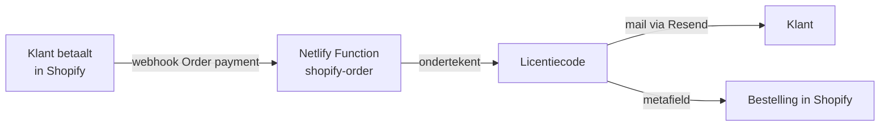

# Licenties en de winkel

## Hoe een licentiecode werkt

Een code is `SPOTI-<gegevens>.<handtekening>`. De gegevens zijn JSON (`id`, `to` = naam en e-mail van de koper, `ed`, `iat`), de handtekening is **ECDSA P-256 / SHA-256**.

* Alleen de **publieke** sleutel zit in SpotiParty (`hub/sp_license.py` en `web/license.js`). Zonder de privésleutel kan niemand een geldige code maken.
* De controle werkt **offline**, zonder server van ons.
* De naam van de koper staat in de code en in het dashboard. Wie zijn code deelt, deelt zijn naam.


Geen enkele controle in software die bij de klant draait is waterdicht: wie de code aanpast, kan de controle eruit halen. Dit houdt het namaken van codes en het achteloos delen tegen, niet een vastberaden kraker.


## De sleutel

```bash
python3 tools/license.py keygen      # eenmalig; is al gedaan
python3 tools/license.py sign "Naam <mail@voorbeeld.nl>" 1001
python3 tools/license.py check SPOTI-...
```

De privésleutel staat in `~/.spotiparty/license-private.json`. **Maak er een back-up van** (bijvoorbeeld in je wachtwoordmanager): zonder die sleutel kun je geen codes meer maken, en een nieuwe sleutel maakt alle verkochte codes ongeldig.

## De Shopify-winkel



1. **Winkel**: maak een Shopify-winkel en twee producten, zonder verzending (*Dit is een fysiek product* uit):
   * **SpotiParty Pro**, SKU `SPOTIPARTY-PRO`, €14,99
   * **SpotiParty Pro × 3**, SKU `SPOTIPARTY-PRO-3`, €29,99
2. **Netlify**: zet de *Base directory* van de site op `site` (dan geldt `site/netlify.toml`) en voeg de omgevingsvariabelen toe die bovenin `site/netlify/functions/shopify-order.mjs` staan. `SPOTIPARTY_LICENSE_JWK` is de inhoud van `~/.spotiparty/license-private.json`.
3. **Mail**: maak een account bij [Resend](https://resend.com), verifieer je domein en zet `RESEND_API_KEY` en `MAIL_FROM`.
4. **Webhook**: in Shopify **Instellingen → Meldingen → Webhooks → Webhook maken**: gebeurtenis **Betaling van bestelling**, JSON, URL `https://spotiparty.netlify.app/.netlify/functions/shopify-order`. Kopieer de geheime sleutel onder de lijst naar `SHOPIFY_WEBHOOK_SECRET`.
5. **Website**: zet de links naar je producten in `SHOP` onderaan `site/index.html`.
6. **Testen**: zet de **Bogus Gateway** aan (*Instellingen → Betalingen*) en doe een testbestelling met je eigen e-mailadres.

Een nieuwe SKU of bundel voeg je toe in `SKUS` bovenin de function.
