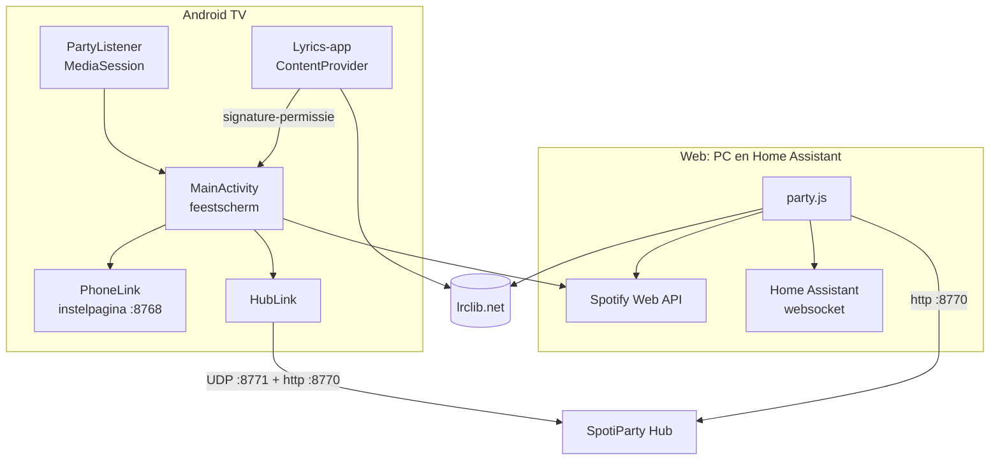

# Projectstructuur

```
SpotiParty/
├── android/
│   ├── party-mode/   SpotiParty voor Android TV (io.github.cleanyourtv.partymode)
│   └── lyrics/       Lyrics-add-on zonder scherm (io.github.cleanyourtv.lyrics)
├── web/              De webversie voor PC, Raspberry Pi en Home Assistant
│   ├── index.html
│   ├── party.js      Spotify, Home Assistant, lrclib en de weergave
│   ├── hub.js        Meldingen, pauze en gasten-wifi van de Hub (Pro)
│   ├── license.js    Licentiecontrole in de browser
│   ├── spotiparty-card.js  De Home Assistant-kaart (volledig scherm met Pro)
│   ├── qr.js         QR-codes zonder bibliotheek
│   ├── serve.py      Kleine server op 127.0.0.1:8769
│   └── start.cmd     Dubbelklik-starter voor Windows
├── hub/              De SpotiParty Hub: admin-dashboard op :8770 (Pro)
│   ├── spotiparty_hub.py   Server, UDP-discovery op :8771
│   ├── dashboard.html
│   └── sp_license.py       Licentiecodes (ECDSA P-256)
├── pi/               Raspberry Pi: install.sh en kiosk.sh
├── tools/license.py  Licentiecodes maken (alleen voor de verkoper)
├── desktop/
│   ├── spotiparty_app.py   De desktop-app (server + venster)
│   ├── installer.iss       Inno Setup-script voor de Windows-installer
│   └── icon.ico / icon.png
├── site/             De website (spotiparty.netlify.app) en de Shopify-webhook (netlify/functions)
├── docs/             Deze documentatie (Git Sync met GitBook)
└── .github/workflows/desktop.yml   Bouwt de desktop-apps
```

## Hoe de onderdelen samenwerken



## Ontwerpkeuzes

* **Geen bibliotheken.** De APK's bevatten geen enkele dependency en de webversie heeft geen build-stap. Dat houdt het klein en controleerbaar.
* **Debug-sleutel.** De Android-apps worden nooit gepubliceerd en worden daarom met de debug-sleutel ondertekend. De Lyrics-app deelt de songteksten via een _signature permission_ (`io.github.cleanyourtv.permission.HOME_WIDGETS`), daarom moeten beide apps dezelfde sleutel hebben.
* **Vaste poorten.** Spotify vergelijkt de Redirect URI letterlijk. Daarom gebruikt de PC altijd poort 8769 en de tv altijd 8768.
* **Alleen loopback.** De PC-server luistert alleen op `127.0.0.1`. Alleen de Hub (`:8770`) luistert op het netwerk, en alles wat iets verandert vraagt de PIN.
* **Schermen vragen, de Hub antwoordt.** Elk scherm vraagt elke 2 seconden `GET /api/screen`; de Hub hoeft nooit een scherm te bereiken. Zo werkt het ook voor browsers en achter firewalls op de tv.
