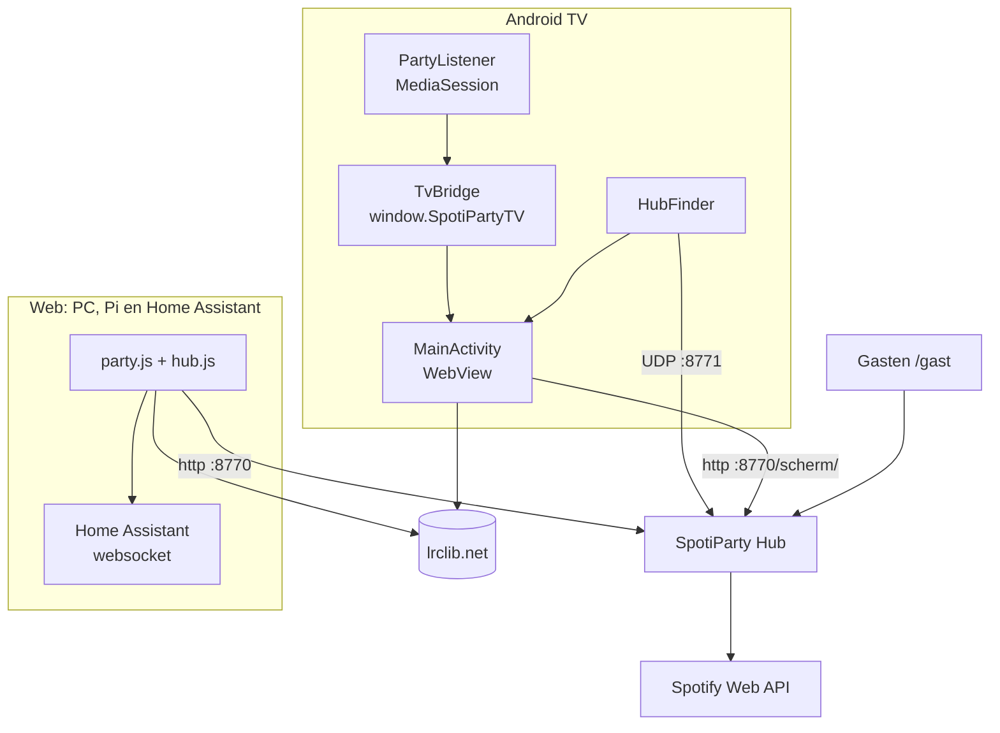

# Projectstructuur

```
SpotiParty/
├── android/
│   ├── party-mode/   SpotiParty voor Android TV: een WebView met http://<hub>:8770/scherm/
│   └── lyrics/       Oude Lyrics-add-on (niet meer nodig)
├── web/              Het feestscherm: PC, Raspberry Pi, Home Assistant en (via de Hub) Android TV
│   ├── index.html
│   ├── party.js      Spotify, Home Assistant, lrclib en de weergave
│   ├── hub.js        Alles van de Hub: Spotify-nummer, Jam, meldingen, pauze, wifi, feestspellen
│   ├── spotiparty-card.js  De Home Assistant-kaart (ook volledig scherm)
│   ├── qr.js         QR-codes zonder bibliotheek
│   ├── icons.js      Iconen (Lucide, ISC-licentie), ook voor het dashboard en de gastenpagina
│   ├── serve.py      Kleine server op 127.0.0.1:8769
│   └── start.cmd     Dubbelklik-starter voor Windows
├── hub/              De SpotiParty Hub: admin-dashboard op :8770
│   ├── spotiparty_hub.py   Server, UDP-discovery op :8771
│   ├── dashboard.html      Het admin-dashboard
│   ├── guest.html          De gastenpagina /gast (Jam, Skip, quiz)
│   ├── sp_spotify.py       Het Spotify-account van de Hub (login, wat speelt, bediening)
│   └── sp_party.py         Skip-stemmen en "Raad het nummer"
├── pi/               Raspberry Pi: install.sh en kiosk.sh
├── server/           De Hub op een Linux-server: install.sh (systemd), Dockerfile, docker-compose.yml
├── desktop/
│   ├── spotiparty_app.py   De desktop-app (scherm + Hub + venster)
│   ├── sp_update.py        Auto-updater: nieuwste GitHub-release (Windows en Mac)
│   ├── sp_version.py       Versie van deze build
│   ├── build-windows.ps1   Bouwt de .exe en de installer
│   ├── build-macos.sh      Bouwt de .app en de .dmg
│   ├── installer.iss       Inno Setup-script voor de Windows-installer
│   └── icon.ico / icon.png
├── dist/spotiparty-card.js   De Home Assistant-kaart in één bestand (tools/build_ha.py)
├── tools/build_ha.py  Bouwt de kaart
├── site/             De website (spotiparty.netlify.app)
├── docs/             Deze documentatie (Git Sync met GitBook)
└── .github/workflows/  desktop.yml (desktop-apps) en android.yml (tv-apps)
```

## Hoe de onderdelen samenwerken



## Ontwerpkeuzes

* **Geen bibliotheken.** De APK's bevatten geen enkele dependency en de webversie heeft geen build-stap. Dat houdt het klein en controleerbaar.
* **Eén scherm voor alles.** Het feestscherm is `web/`. De Hub serveert het op `/scherm/`, en de Android TV-app is een WebView die het daar laadt. Een update van de Hub is daarmee ook een update van elke tv. De app geeft de pagina `window.SpotiPartyTV` (`TvBridge`): wat er op de tv zelf speelt en de mediaknoppen.
* **Debug-sleutel.** De Android-app wordt nooit gepubliceerd en wordt daarom met de debug-sleutel ondertekend.
* **Spotify alleen in de Hub.** Sinds 2.5.0 logt alleen de Hub in bij Spotify (Redirect URI `http://127.0.0.1:8770/spotify/callback`). De schermen vragen de Hub wat er speelt; zo is er één login en één Client ID voor alles.
* **Vaste poorten.** Scherm op 8769, Hub op 8770, Hub-discovery via UDP op 8771.
* **Alleen loopback.** De PC-server luistert alleen op `127.0.0.1`. Alleen de Hub (`:8770`) luistert op het netwerk, en alles wat iets verandert vraagt de PIN.
* **Schermen vragen, de Hub antwoordt.** Elk scherm vraagt elke 2 seconden `GET /api/screen`; de Hub hoeft nooit een scherm te bereiken. Zo werkt het ook voor browsers en achter firewalls op de tv.
