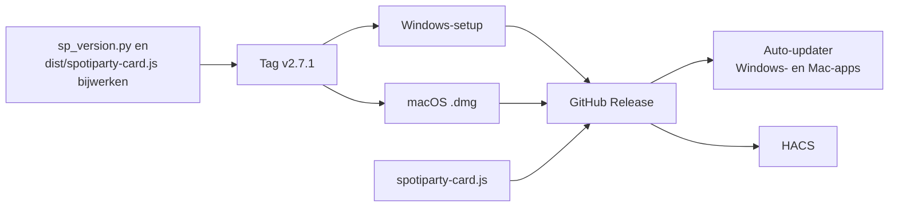

# Een release maken

Een release op GitHub is voor drie dingen tegelijk de bron:

| Wie                         | Zoekt in de nieuwste release naar          |
| --------------------------- | ------------------------------------------ |
| Mensen die downloaden       | `SpotiParty-Setup-<versie>.exe`            |
| De **auto-updater** (Windows, vanaf 3.2.1) | `SpotiParty-Setup-<versie>.exe`, met precies die naam |
| De **auto-updater** (Mac, vanaf 2.7.1) | `SpotiParty-macos-apple-silicon.dmg` en `SpotiParty-macos-intel.dmg`, met precies die naam |
| **HACS** (Home Assistant)   | `spotiparty-card.js` als bijlage           |

De nieuwste release is nu [**v3.7.1**](https://github.com/CodeAura/SpotiParty/releases/tag/v3.7.1), met `SpotiParty-Setup-3.7.1.exe`, `SpotiParty-macos-apple-silicon.dmg` en `spotiparty-card.js`.

## Stap voor stap



### Kies het versienummer

Altijd drie getallen, zoals `2.7.1`. De auto-updater vergelijkt het met de versie in de app (`desktop/sp_version.py`) en installeert alleen een **hogere** versie.



### Schrijf wat er nieuw is

Zet het nieuwe versienummer en twee of drie korte punten in `hub/whats_new.json`. Het Hub-dashboard toont dat één keer na de update ("Wat is er nieuw"), behalve bij wie het heeft uitgezet of het dashboard voor het eerst gebruikt.



### Bouw de Windows-setup

Op een Windows-pc of -VM:

```powershell
powershell -ExecutionPolicy Bypass -File desktop\build-windows.ps1 -Version 2.7.1
```

Het script schrijft het versienummer in `desktop/sp_version.py`, bouwt `SpotiParty.exe`, test of de pagina en de Hub antwoorden en maakt `desktop\dist\SpotiParty-Setup-2.7.1.exe`. Commit de gewijzigde `sp_version.py`. Zie [Desktop-app zelf bouwen](desktop-app-bouwen.md).



### Bouw de Mac-app

Op een Mac met Apple silicon, **nadat** `desktop/sp_version.py` het nieuwe nummer heeft:

```bash
./desktop/build-macos.sh
```

Resultaat: `desktop/dist/SpotiParty-macos-apple-silicon.dmg`. Het script zet het versienummer in de app; de Mac-updater installeert de `.dmg` alleen als dat nummer **precies** gelijk is aan de tag. Op een Intel-Mac maak je zo `SpotiParty-macos-intel.dmg`.



### Bouw de Home Assistant-kaart

Na een wijziging in `web/`:

```bash
python tools/build_ha.py
```

Dat maakt `dist/spotiparty-card.js`, met het hele scherm erin. Commit die ook.



### Maak de release

Maak op GitHub een release met tag `v2.7.1` en zet de bestanden erbij als bijlage: `SpotiParty-Setup-2.7.1.exe`, `SpotiParty-macos-apple-silicon.dmg` en `spotiparty-card.js`. Schrijf de releasenotes in het Nederlands, zoals de eerdere releases.




* Mist `spotiparty-card.js`, dan meldt HACS _"The installed content has no spotiparty-card.js"_.
* Heet de setup anders dan `SpotiParty-Setup-<versie>.exe`, of is de versie niet hoger, dan ziet de auto-updater hem niet.
* Heet de `.dmg` anders, of klopt het versienummer in de Mac-app niet met de tag, dan laat de Mac-updater hem staan.


## Bouwen met GitHub Actions

De workflow `.github/workflows/desktop.yml` (**Desktop apps**) kan ook bouwen:

| Job                     | Draait op        | Maakt                                                                                     |
| ----------------------- | ---------------- | ----------------------------------------------------------------------------------------- |
| `windows`               | `windows-latest` | `SpotiParty.exe` en `SpotiParty-Setup-<versie>.exe`, plus een rooktest voor de pagina en de Hub |
| `macos` (apple-silicon) | `macos-latest`   | `SpotiParty-macos-apple-silicon.dmg`                                                      |
| `macos` (intel)         | `macos-15-intel` | `SpotiParty-macos-intel.dmg`                                                              |
| `release`               | `ubuntu-latest`  | Zet alle bestanden bij de release (alleen bij een tag)                                    |

Een testbuild start je met **Actions → Desktop apps → Run workflow**; de bestanden staan dan onder **Artifacts**. Een tag die met `v` begint start de hele workflow:

```bash
git tag v2.7.1
git push origin v2.7.1
```


De workflow schrijft het versienummer **niet** in `desktop/sp_version.py`. Werk dat bestand dus bij vóór je de tag pusht, anders denkt de app dat hij een oudere versie is en blijft hij updates aanbieden. Ook `spotiparty-card.js` zet de workflow niet bij de release: voeg die met de hand toe.




De Android TV-app zit niet in de release: die bouwt iedereen zelf. Het scherm op de tv komt van de Hub, dus een nieuwe release van de Hub is meteen een update van elke tv. De workflow **Android TV apps** bouwt ze wel als controle; de APK's staan dan onder **Artifacts**. Zie [Stap 2: De apps bouwen](../android-tv/stap-2-bouwen.md).
