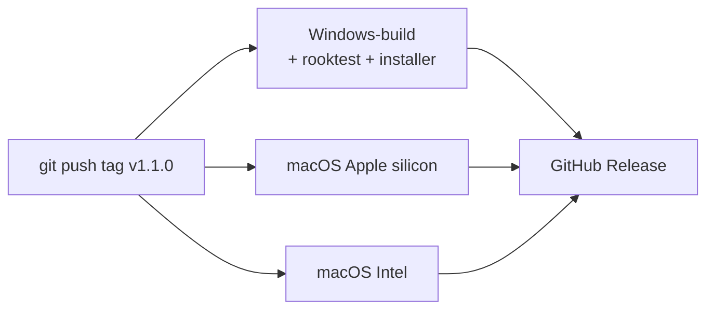

# Een release maken

De workflow `.github/workflows/desktop.yml` (**Desktop apps**) bouwt alle desktopversies.

| Job                     | Draait op        | Maakt                                                                                                               |
| ----------------------- | ---------------- | ------------------------------------------------------------------------------------------------------------------- |
| `windows`               | `windows-latest` | `SpotiParty.exe` en `SpotiParty-Setup-<versie>.exe`, plus een rooktest die controleert of de app de pagina serveert |
| `macos` (apple-silicon) | `macos-latest`   | `SpotiParty-macos-apple-silicon.dmg`                                                                                |
| `macos` (intel)         | `macos-15-intel` | `SpotiParty-macos-intel.dmg`                                                                                        |
| `release`               | `ubuntu-latest`  | Een GitHub-release met alle bestanden (alleen bij een tag)                                                          |

## Een testbuild

Ga op GitHub naar **Actions → Desktop apps → Run workflow**. De bestanden verschijnen onder **Artifacts** van die run. De installer krijgt dan versie `0.0.0-dev`.

## Een echte release

Push een tag die met `v` begint:

```bash
git tag v1.1.0
git push origin v1.1.0
```

De workflow bouwt alles, haalt het versienummer uit de tag (`v1.1.0` wordt `1.1.0`) en maakt een release met alle bestanden.




De Android-apps zitten niet in de release: die bouwt iedereen zelf, zodat SpotiParty en Lyrics dezelfde sleutel hebben. Zie [Stap 2: De apps bouwen](../android-tv/stap-2-bouwen.md).

