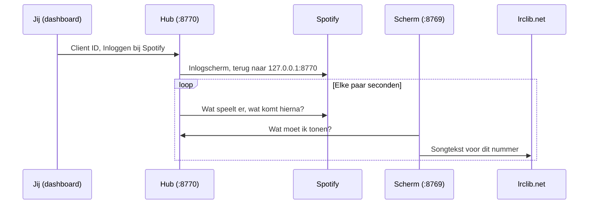

# PC (Windows, Mac en Linux)

Op de PC is SpotiParty twee dingen tegelijk: een **feestscherm** en de [**SpotiParty Hub**](../hub/hub-dashboard.md), het dashboard voor al je schermen. Het scherm volgt **je Spotify-account**, gekoppeld in de Hub. Het maakt dus niet uit waar de muziek speelt: op je telefoon, je speaker, je tv of de PC zelf. Zet je computer aan een tweede scherm of beamer en je hebt een feestscherm.

## Kies hoe je start

<table data-view="cards"><thead><tr><th></th><th></th><th data-hidden data-card-target data-type="content-ref"></th></tr></thead><tbody><tr><td><strong>🪟 Windows-app</strong></td><td>Installer, met automatische updates. Geen beheerdersrechten nodig.</td><td><a href="windows.md">windows.md</a></td></tr><tr><td><strong>🍎 Mac</strong></td><td>App voor Apple silicon, met automatische updates.</td><td><a href="macos.md">macos.md</a></td></tr><tr><td><strong>🐍 Met Python</strong></td><td>Werkt overal waar Python 3 draait, ook op Linux. Geen installatie.</td><td><a href="python.md">python.md</a></td></tr></tbody></table>

## Wat heb je nodig?

* **Een eigen Spotify-app** om je account aan de Hub te koppelen, met de Redirect URI `http://127.0.0.1:8770/spotify/callback`. Zie [Je eigen Spotify-app maken](../aan-de-slag/spotify-app.md).
* Voor de nette app-weergave (eigen venster, geen tabbladen): **Microsoft Edge, Google Chrome, Brave of Chromium**. Heb je geen van deze, dan opent SpotiParty in je standaardbrowser. Dat werkt ook prima.

## Hoe het werkt

De app start twee kleine webservers:

| Adres                        | Wat                         | Wie kan erbij                                    |
| ---------------------------- | --------------------------- | ------------------------------------------------ |
| `http://127.0.0.1:8769`      | Het feestscherm             | Alleen deze computer                             |
| `http://<deze-pc>:8770`      | De Hub, het dashboard en de gastenpagina `/gast` | Je eigen netwerk (alles wat iets verandert vraagt de PIN) |

Er draait één Hub per netwerk. Start je de app op een tweede pc, dan wordt die een scherm van de eerste Hub.

Na de installatie ga je verder met [Instellen op de PC](instellen.md).
