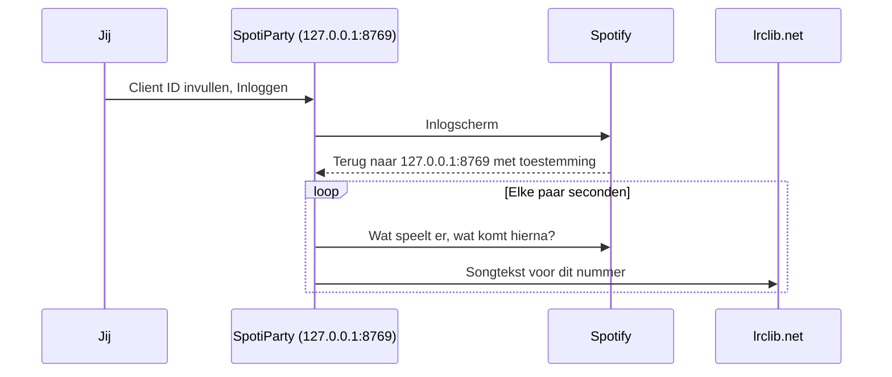

# PC (Windows, Mac en Linux)

Op de PC volgt SpotiParty **je Spotify-account**. Het maakt dus niet uit waar de muziek speelt: op je telefoon, je speaker, je tv of de PC zelf. Zet je computer aan een tweede scherm of beamer en je hebt een feestscherm.

## Kies hoe je start

<table data-view="cards"><thead><tr><th></th><th></th><th data-hidden data-card-target data-type="content-ref"></th></tr></thead><tbody><tr><td><strong>🪟 Windows-app</strong></td><td>Installer of los <code>.exe</code>-bestand. Geen beheerdersrechten nodig.</td><td><a href="windows.md">windows.md</a></td></tr><tr><td><strong>🍎 Mac-app</strong></td><td>Een <code>.dmg</code> voor Apple silicon en voor Intel.</td><td><a href="macos.md">macos.md</a></td></tr><tr><td><strong>🐍 Met Python</strong></td><td>Werkt overal waar Python 3 draait, ook op Linux. Geen installatie.</td><td><a href="python.md">python.md</a></td></tr></tbody></table>

## Wat heb je nodig?

* **Een eigen Spotify-app** met de Redirect URI `http://127.0.0.1:8769/index.html`. Dit is verplicht voor de PC-versie, zie [Je eigen Spotify-app maken](../aan-de-slag/spotify-app.md).
* Voor de nette app-weergave (eigen venster, geen tabbladen): **Microsoft Edge, Google Chrome, Brave of Chromium**. Heb je geen van deze, dan opent SpotiParty in je standaardbrowser. Dat werkt ook prima.

## Hoe het werkt

De app en het Python-script doen allebei hetzelfde: ze starten een klein webservertje op `http://127.0.0.1:8769`. Dat adres luistert **alleen op je eigen computer**, niemand anders in het netwerk kan erbij. Spotify accepteert dat adres als terugkeeradres na het inloggen; daarom moet het precies kloppen.

Na de installatie ga je verder met [Instellen op de PC](instellen.md).
